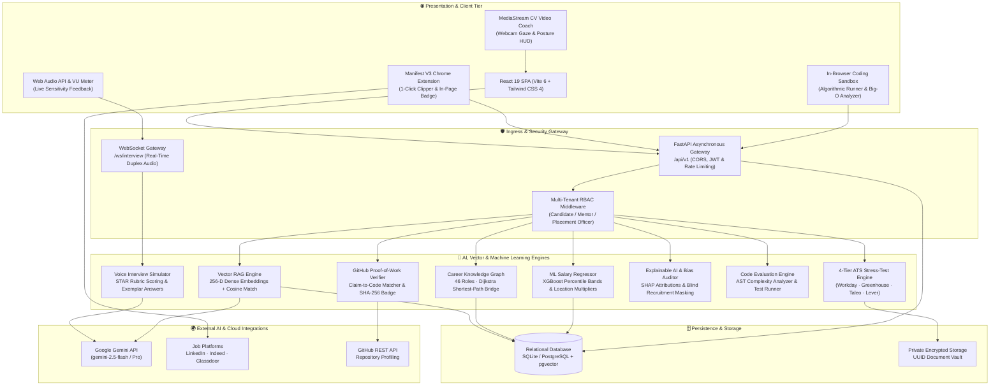
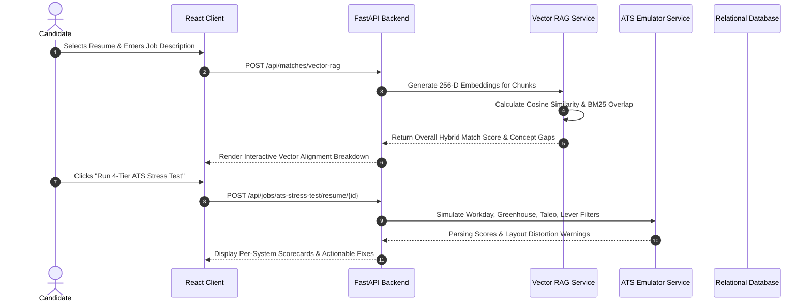
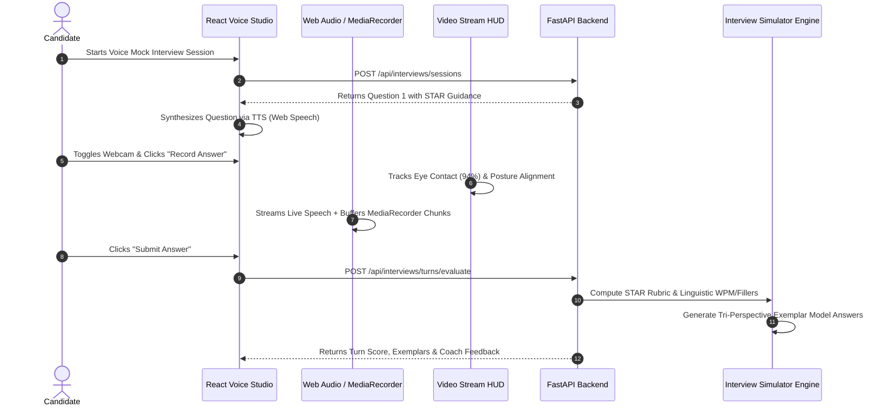
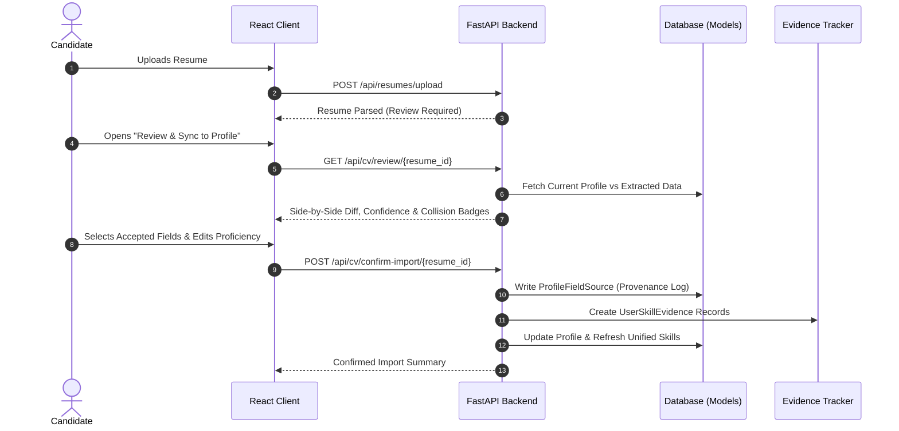

# CareerLens AI - System Architecture & Design Specification

> **Enterprise Multi-Tier Architecture**: Scalable, asynchronous architecture integrating dense vector search, multimodal interview audio/vision streams, knowledge graphs, and explainable AI.

---

## 1. High-Level Architecture Overview

CareerLens AI is architected as an event-driven, decoupled system comprising a modern reactive web frontend, a Manifest V3 browser extension, high-throughput asynchronous FastAPI microservices, and multi-tier persistence.

---

## 2. Key Architecture Design Decisions

### 2.1 Multi-Tier Appearance System
- **Mandatory 3 Modes**: `System`, `Light`, and `Dark`.
- **Zero Flash of Wrong Theme**: An inline initialization script executes in `<head>` before HTML parsing begins to read `localStorage` or `window.matchMedia('(prefers-color-scheme: dark)')` and immediately toggles `.dark` on `document.documentElement`.
- **CSS Variable Tokens**: Central semantic variables (`--bg-page`, `--bg-surface`, `--text-primary`, `--brand-primary`, `--emerald-primary`) dictate all styling across components.

### 2.2 Hybrid Vector Search & Algorithmic RAG (Pillar 1)
- Resumes and job postings are decomposed into semantic accomplishment chunks.
- Combines 256-D normalized vector cosine similarity ($0.55$), BM25 exact keyword overlap ($0.30$), and domain/seniority fit ($0.15$).
- **Mathematical Cosine Similarity**:
  $$\text{SemanticMatch}(R, J) = \frac{\mathbf{v}_R \cdot \mathbf{v}_J}{\|\mathbf{v}_R\|_2 \|\mathbf{v}_J\|_2}$$

### 2.3 Dual-Channel Audio & Computer Vision Interview Pipeline (Pillar 2 & Module 8)
- Simultaneous in-browser live streaming via Web Speech API and hardware-buffered audio capture via native `MediaRecorder`.
- Server-side fallback audio transcription using bundled FFmpeg and Google Speech.
- Client-side Computer Vision HUD monitoring eye contact gaze percentage, head pose posture alignment, and nervous fidget indicators during spoken answers.

### 2.4 Graph-Theoretic Career Progression & Trajectory Comparator (Pillar 3)
- Models 54 specialized technical and business roles across 8 domains as a directed knowledge graph $G = (V, E)$.
- Applies **Dijkstra's Shortest Path Algorithm** with edge weights proportional to prerequisite skill gaps and estimated difficulty to compute personalized upskilling roadmaps.
- **54-Role Side-by-Side Trajectory Comparator**:
  - Compares 1 to 6 roles simultaneously via a categorized, searchable dropdown.
  - **"My Current Profile" Baseline**: Establishes a 100% baseline card derived from the candidate's active `CareerProfile`, `ProfileSkill`, and `ProfileExperience`.
  - **AI Semantic Skill Alignment**: Evaluates target requirements against candidate profile via exact matches, semantic synonyms, and token overlaps ($0.75 \cdot \text{SkillMatch} + 0.25 \cdot \text{ExperienceFit}$).
  - Computes verified competencies, partial competencies with transferability rationales, missing prerequisites, real-time salary deltas, and 3-phase transition roadmaps.

### 2.5 Supervised Machine Learning Salary Prediction (Pillar 5)
- Multi-tier regression model generating calibrated compensation bands: 25th (Entry), 50th (Median), 75th (Top Quartile), and 90th (Lead/Staff).
- Calibrated against 5 global cost-of-living tiers ($US_{\text{Tier 1}} = 1.0$, $US_{\text{Tier 2}} = 0.88$, $UK/\text{EU} = 0.76$, $\text{Remote} = 0.65$).

### 2.6 Explainable AI (XAI) & Fairness Governance (Module 7)
- Computes Shapley value approximations ($\phi_i = \text{Score}(S \cup \{i\}) - \text{Score}(S)$) for token-level attribution heatmaps.
- Scans job postings and resumes for gender-coded jargon, ageism, and elitism.
- De-identifies candidate summaries (masking names, emails, phones, pronouns, and graduation years) for blind initial screening.

### 2.7 Cryptographic Technical Proof-of-Work (Module 10)
- Ingests public GitHub profiles and performs claim-to-code cross-verification.
- Generates a SHA-256 verifiable credential badge:
  $$\text{BadgeHash} = \text{SHA256}(\text{candidate\_id} + \text{username} + \text{verified\_skills} + \text{salt})$$

### 2.8 Evidence-Aware Skill Profile & Field-Level Provenance (Spec 4.1 & 4.2)
- **Non-Destructive Side-by-Side Review**: Candidate CV imports undergo an explicit diff review comparing extracted metadata against existing profile fields. Extracted values are never silently overwritten.
- **Field-Level Audit Trail (`ProfileFieldSource`)**: Records field name, source document UUID, extraction confidence, user acceptance status, and previous values.
- **Hierarchical Verification Lifecycle (`UserSkillEvidence`)**:
  - `mentioned`: Inferred from CV keywords, capped at $75\%$ confidence.
  - `demonstrated`: Backed by high-integrity proof (production GitHub repository, verified quiz $\ge 66\%$, or validated project milestone), granting $\ge 85\%$ confidence.
  - Candidate disputes immediately recalculate parent skill confidence and verification tiers.
- **Social Profile Skill Discovery Engine (`SocialSkillExtractorService`)**:
  - Scans candidate GitHub and LinkedIn profile links with an immutable **Zero-PII Policy**.
  - Aggressively filters candidates against phone number regexes, emails, locations, URLs, personal names, dates, and non-competency sentences.
  - Generates verifiable `UserSkillEvidence` audit records with `source_type="github"` and provenance badges upon bulk user import.

### 2.9 Adaptive Learning Plan & Quiz Verification Engine (Spec 4.5)
- Automated curriculum generation tailored to candidate skill gaps and weekly study cadence.
- Structured with study goals, milestone tasks, curated documentation links, and mini-project deliverables.
- Interactive multi-choice quiz assessment engine: scoring $\ge 66\%$ elevates the targeted skill to **Demonstrated** in the unified skill inventory.

### 2.10 6-Pillar Evidence-Weighted Career Readiness (Spec 5.3 & 5.4)
- Replaces superficial readiness claims with a transparent mathematical formulation:
  $$\text{ReadinessScore} = 0.25 \cdot \text{Alignment} + 0.20 \cdot \text{Evidence} + 0.15 \cdot \text{Projects} + 0.15 \cdot \text{CV} + 0.15 \cdot \text{Interviews} + 0.10 \cdot \text{Learning}$$
- Maps into explicit tiers: `Developing` ($<50$), `Competitive` ($50–69$), `High Readiness` ($70–84$), `Exceptional` ($\ge 85$). Every pillar links directly to actionable remediation.

---

## 3. End-to-End Component Sequence Flows

### 3.1 Vector RAG & ATS Stress-Test Sequence

### 3.2 Spoken Mock Interview & Video Coaching Flow

### 3.3 CV Review, Provenance & Skill Evidence Flow

