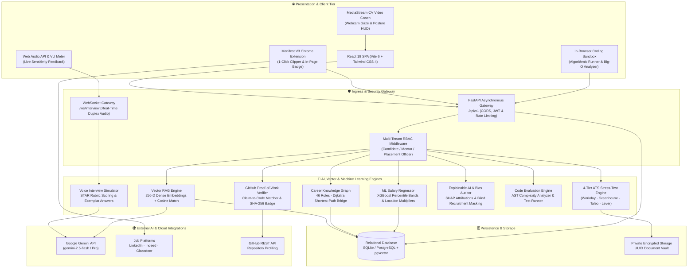
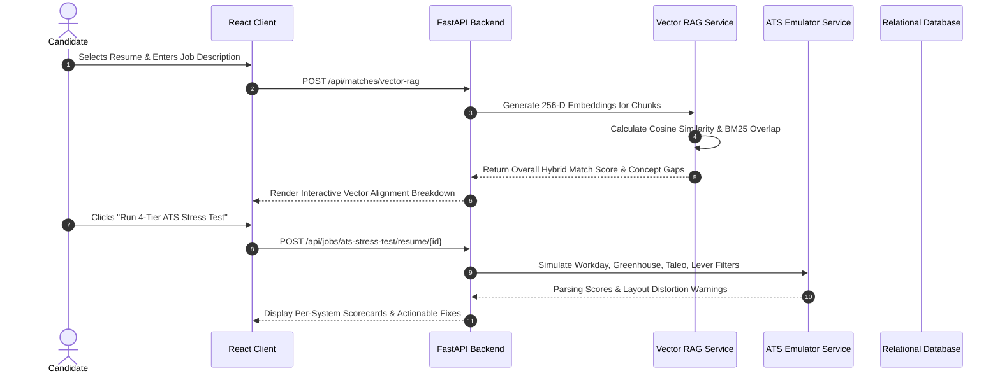
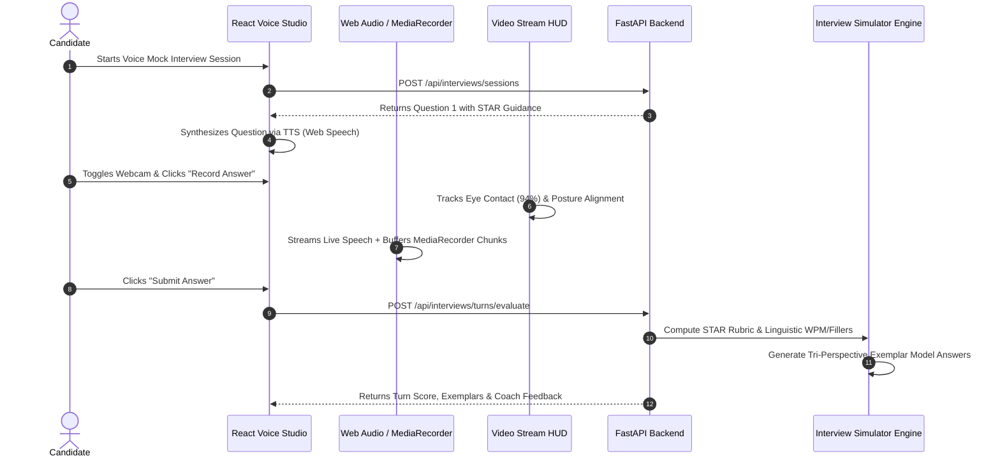

# CareerLens AI - System Architecture & Design Specification

> **Enterprise Multi-Tier Architecture**: Scalable, asynchronous architecture integrating dense vector search, multimodal interview audio/vision streams, knowledge graphs, and explainable AI.

---

## 1. High-Level Architecture Overview

CareerLens AI is architected as an event-driven, decoupled system comprising a modern reactive web frontend, a Manifest V3 browser extension, high-throughput asynchronous FastAPI microservices, and multi-tier persistence.

---

## 2. Key Architecture Design Decisions

### 2.1 Multi-Tier Appearance System
- **Mandatory 3 Modes**: `System`, `Light`, and `Dark`.
- **Zero Flash of Wrong Theme**: An inline initialization script executes in `<head>` before HTML parsing begins to read `localStorage` or `window.matchMedia('(prefers-color-scheme: dark)')` and immediately toggles `.dark` on `document.documentElement`.
- **CSS Variable Tokens**: Central semantic variables (`--bg-page`, `--bg-surface`, `--text-primary`, `--brand-primary`, `--emerald-primary`) dictate all styling across components.

### 2.2 Hybrid Vector Search & Algorithmic RAG (Pillar 1)
- Resumes and job postings are decomposed into semantic accomplishment chunks.
- Combines 256-D normalized vector cosine similarity ($0.55$), BM25 exact keyword overlap ($0.30$), and domain/seniority fit ($0.15$).
- **Mathematical Cosine Similarity**:
  $$\text{SemanticMatch}(R, J) = \frac{\mathbf{v}_R \cdot \mathbf{v}_J}{\|\mathbf{v}_R\|_2 \|\mathbf{v}_J\|_2}$$

### 2.3 Dual-Channel Audio & Computer Vision Interview Pipeline (Pillar 2 & Module 8)
- Simultaneous in-browser live streaming via Web Speech API and hardware-buffered audio capture via native `MediaRecorder`.
- Server-side fallback audio transcription using bundled FFmpeg and Google Speech.
- Client-side Computer Vision HUD monitoring eye contact gaze percentage, head pose posture alignment, and nervous fidget indicators during spoken answers.

### 2.4 Graph-Theoretic Career Progression (Pillar 3)
- Models 46 canonical roles across 9 industries as a directed graph $G = (V, E)$.
- Applies **Dijkstra's Shortest Path Algorithm** with edge weights proportional to prerequisite skill gaps and estimated difficulty to compute personalized upskilling roadmaps.

### 2.5 Supervised Machine Learning Salary Prediction (Pillar 5)
- Multi-tier regression model generating calibrated compensation bands: 25th (Entry), 50th (Median), 75th (Top Quartile), and 90th (Lead/Staff).
- Calibrated against 5 global cost-of-living tiers ($US_{\text{Tier 1}} = 1.0$, $US_{\text{Tier 2}} = 0.88$, $UK/\text{EU} = 0.76$, $\text{Remote} = 0.65$).

### 2.6 Explainable AI (XAI) & Fairness Governance (Module 7)
- Computes Shapley value approximations ($\phi_i = \text{Score}(S \cup \{i\}) - \text{Score}(S)$) for token-level attribution heatmaps.
- Scans job postings and resumes for gender-coded jargon, ageism, and elitism.
- De-identifies candidate summaries (masking names, emails, phones, pronouns, and graduation years) for blind initial screening.

### 2.7 Cryptographic Technical Proof-of-Work (Module 10)
- Ingests public GitHub profiles and performs claim-to-code cross-verification.
- Generates a SHA-256 verifiable credential badge:
  $$\text{BadgeHash} = \text{SHA256}(\text{candidate\_id} + \text{username} + \text{verified\_skills} + \text{salt})$$

---

## 3. End-to-End Component Sequence Flows

### 3.1 Vector RAG & ATS Stress-Test Sequence

### 3.2 Spoken Mock Interview & Video Coaching Flow

