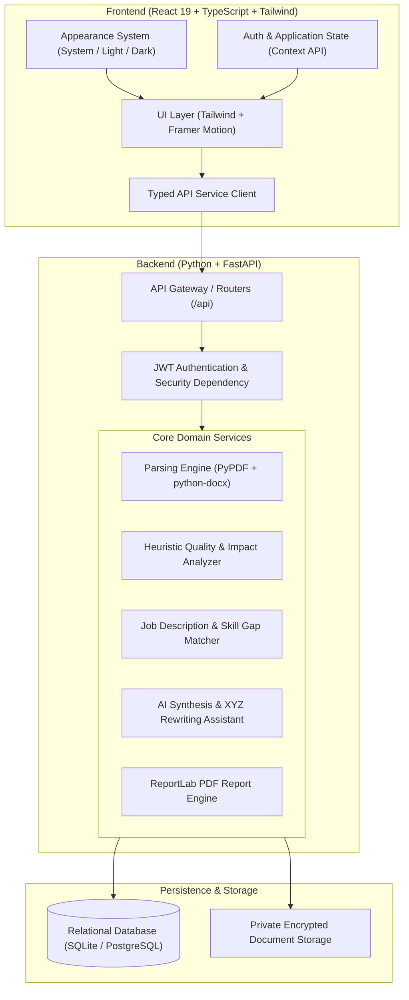
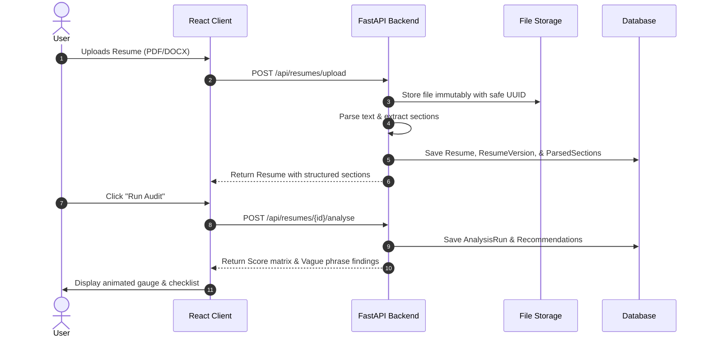

# CareerLens AI - System Architecture & Design Specification

## 1. High-Level Architecture Overview

CareerLens AI is engineered as a decoupled, multi-tiered architecture featuring a modern reactive frontend, a high-throughput asynchronous Python FastAPI backend, a relational database, and private document storage.

---

## 2. Key Architecture Design Decisions

### 2.1 Multi-Tier Appearance System
- **Mandatory 3 Modes**: `System`, `Light`, and `Dark`.
- **Zero Flash of Wrong Theme**: An inline initialization script runs in `<head>` before HTML parsing begins to read `localStorage` or `window.matchMedia('(prefers-color-scheme: dark)')` and immediately toggles `.dark` on `document.documentElement`.
- **CSS Variable Tokens**: Central semantic variables (`--bg-page`, `--bg-surface`, `--text-primary`, `--brand-primary`, `--emerald-primary`) dictate all color mapping across components.

### 2.2 Document Immutability & Section Correction
- Uploaded PDF and DOCX files are stored immutably in a private storage folder with cryptographically randomized UUID names.
- Extracted text is segmented into `ParsedResumeSection` entities (`contact`, `summary`, `experience`, `education`, `skills`, `projects`, `certifications`).
- When a user corrects or edits a parsed field in the Review UI, the system marks the section `is_user_verified = true` without modifying or overwriting the original uploaded file.

### 2.3 Transparent Heuristic Quality Engine
- Rather than opaque black-box AI scores, CareerLens AI uses a documented, multi-dimensional scoring rubric:
  $$\text{Overall Score} = 0.35 \times \text{Impact} + 0.25 \times \text{Structure} + 0.20 \times \text{Readability} + 0.20 \times \text{Skills}$$
- **Vague Phrase Detection**: Identifies overused passive responsibility statements (e.g., "responsible for", "helped with", "worked on") and provides high-impact, truthful action verbs.
- **Strict Compliance**: Disclaimers are displayed everywhere to clarify that scores are self-improvement heuristics, not employer ATS predictions.

### 2.4 Evidence-Grounded AI Assistant
- The AI writing assistant enforces the Google XYZ formula: *"Accomplished [X] as measured by [Y] by doing [Z]"*.
- Cover letters and summary proposals are strictly grounded in candidate-verified resume facts and supplied job descriptions, preventing fabricated qualifications.

### 2.5 Security, Privacy & Data Isolation
- Server-side tenant isolation: Every query filters strictly by `user_id == current_user.id`.
- GDPR Compliance: Full JSON data export endpoint (`GET /api/users/export`) and permanent account/resume deletion (`DELETE /api/users/account`).

---

## 3. Component Interaction Flow

