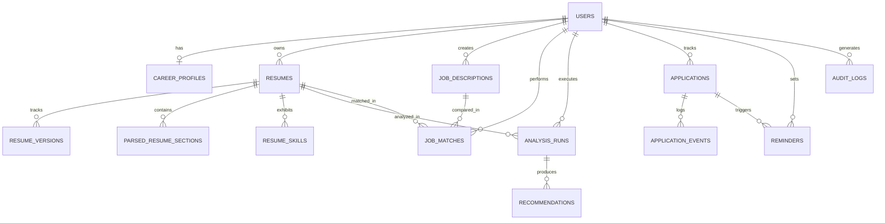

# CareerLens AI - Database Design & Schema Specification

## 1. Entity-Relationship Overview

CareerLens AI utilizes a normalized relational schema with cascading foreign keys, audit tracking, JSON column capabilities, and strict user ownership isolation.



---

## 2. Table Definitions

### 2.1 `users`
| Column | Type | Constraints | Description |
|---|---|---|---|
| `id` | VARCHAR(36) | PRIMARY KEY | Unique UUID identifier |
| `email` | VARCHAR(255) | UNIQUE, INDEX, NOT NULL | Account email address |
| `hashed_password` | VARCHAR(255) | NOT NULL | Salted bcrypt hash |
| `full_name` | VARCHAR(255) | NULLABLE | User's full display name |
| `appearance_preference`| VARCHAR(20) | DEFAULT 'system' | 'system', 'light', or 'dark' |
| `is_active` | BOOLEAN | DEFAULT TRUE | Account active flag |
| `created_at` | TIMESTAMP | DEFAULT UTC NOW | Creation timestamp |
| `updated_at` | TIMESTAMP | ON UPDATE UTC NOW | Last modified timestamp |

### 2.2 `career_profiles`
| Column | Type | Constraints | Description |
|---|---|---|---|
| `id` | VARCHAR(36) | PRIMARY KEY | Profile UUID |
| `user_id` | VARCHAR(36) | UNIQUE, FK `users.id` ON DELETE CASCADE | Owner identity |
| `target_title` | VARCHAR(255) | NULLABLE | Desired role title |
| `target_industry` | VARCHAR(255) | NULLABLE | Industry sector |
| `years_of_experience` | INTEGER | DEFAULT 0 | Years in career |
| `preferred_locations` | JSON | DEFAULT '[]' | Target city/remote preferences |
| `desired_salary_min` | INTEGER | NULLABLE | Target base minimum |
| `desired_salary_max` | INTEGER | NULLABLE | Target base maximum |
| `summary` | TEXT | NULLABLE | Elevator pitch |
| `skills_list` | JSON | DEFAULT '[]' | Verified skills list |
| `updated_at` | TIMESTAMP | ON UPDATE UTC NOW | Last updated |

### 2.3 `resumes`
| Column | Type | Constraints | Description |
|---|---|---|---|
| `id` | VARCHAR(36) | PRIMARY KEY | Resume UUID |
| `user_id` | VARCHAR(36) | FK `users.id` ON DELETE CASCADE, INDEX | Owner identity |
| `title` | VARCHAR(255) | NOT NULL | User-assigned document title |
| `target_role` | VARCHAR(255) | NULLABLE | Target role label |
| `file_name` | VARCHAR(255) | NOT NULL | Original upload filename |
| `file_path` | VARCHAR(500) | NOT NULL | Server private storage path |
| `file_size` | INTEGER | DEFAULT 0 | File size in bytes |
| `file_type` | VARCHAR(50) | NOT NULL | Extension: 'pdf', 'docx', 'txt' |
| `raw_text` | TEXT | NULLABLE | Full extracted plain text |
| `is_archived` | BOOLEAN | DEFAULT FALSE | Soft archive flag |
| `created_at` | TIMESTAMP | DEFAULT UTC NOW | Upload timestamp |

### 2.4 `parsed_resume_sections`
| Column | Type | Constraints | Description |
|---|---|---|---|
| `id` | VARCHAR(36) | PRIMARY KEY | Section UUID |
| `resume_id` | VARCHAR(36) | FK `resumes.id` ON DELETE CASCADE, INDEX | Parent resume |
| `section_type` | VARCHAR(50) | NOT NULL | 'contact', 'summary', 'experience', etc. |
| `raw_content` | TEXT | NULLABLE | Plain text content |
| `structured_data`| JSON | DEFAULT '{}' | Normalized JSON representation |
| `is_user_verified`| BOOLEAN | DEFAULT FALSE | User review flag |
| `updated_at` | TIMESTAMP | ON UPDATE UTC NOW | Last modified timestamp |

### 2.5 `analysis_runs`
| Column | Type | Constraints | Description |
|---|---|---|---|
| `id` | VARCHAR(36) | PRIMARY KEY | Analysis run UUID |
| `user_id` | VARCHAR(36) | FK `users.id` ON DELETE CASCADE, INDEX | User identity |
| `resume_id` | VARCHAR(36) | FK `resumes.id` ON DELETE CASCADE, INDEX | Target resume |
| `overall_score` | FLOAT | NOT NULL | Overall heuristic score (0-100) |
| `structure_score`| FLOAT | DEFAULT 0.0 | Layout score (0-100) |
| `readability_score`| FLOAT | DEFAULT 0.0 | Readability score (0-100) |
| `impact_score` | FLOAT | DEFAULT 0.0 | Quantified outcomes score (0-100) |
| `skills_score` | FLOAT | DEFAULT 0.0 | Keyword breadth score (0-100) |
| `findings` | JSON | DEFAULT '[]' | High-level audit bullet points |
| `vague_phrases` | JSON | DEFAULT '[]' | Detected passive expressions & alternatives |
| `strengths` | JSON | DEFAULT '[]' | Identified positives |
| `weaknesses` | JSON | DEFAULT '[]' | Areas for improvement |
| `recommendations`| JSON | DEFAULT '[]' | Prioritized checklist items |
| `created_at` | TIMESTAMP | DEFAULT UTC NOW | Execution timestamp |

### 2.6 `applications`
| Column | Type | Constraints | Description |
|---|---|---|---|
| `id` | VARCHAR(36) | PRIMARY KEY | Application UUID |
| `user_id` | VARCHAR(36) | FK `users.id` ON DELETE CASCADE, INDEX | Owner identity |
| `company` | VARCHAR(255) | NOT NULL | Employer name |
| `role` | VARCHAR(255) | NOT NULL | Position title |
| `stage` | VARCHAR(50) | DEFAULT 'applied', INDEX | 'interested', 'applied', 'interview', etc. |
| `location` | VARCHAR(255) | NULLABLE | Geographic location or 'Remote' |
| `source` | VARCHAR(100) | NULLABLE | Application channel (Referral, LinkedIn) |
| `salary_range` | VARCHAR(100) | NULLABLE | Target or offered compensation |
| `application_date`| TIMESTAMP | NULLABLE | Date submitted |
| `interview_date`| TIMESTAMP | NULLABLE | Scheduled interview date/time |
| `notes` | TEXT | NULLABLE | Notes and recruiter contact details |
| `created_at` | TIMESTAMP | DEFAULT UTC NOW | Record creation timestamp |

---

## 3. Database Migration & Seeding Instructions

### 3.1 Initial Table Creation
Tables are automatically generated on backend startup using SQLAlchemy's declarative metadata:
```python
Base.metadata.create_all(bind=engine)
```

### 3.2 Seeding Demo Data
To populate the database with realistic test resumes, job descriptions, analysis audits, and applications:
```bash
python database/seed-data/seed.py
```
This sets up demo account credentials:
- **Email**: `demo@careerlens.ai`
- **Password**: `CareerLens2026!`
