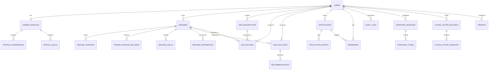

# CareerLens AI - Database Design & Schema Specification

## 1. Entity-Relationship Overview

CareerLens AI utilizes a normalized relational schema with cascading foreign keys, audit logging, JSON column capabilities, and strict user ownership data isolation.



---

## 2. Table Definitions

### 2.1 `users`
| Column | Type | Constraints | Description |
|---|---|---|---|
| `id` | VARCHAR(36) | PRIMARY KEY | Unique UUID identifier |
| `email` | VARCHAR(255) | UNIQUE, INDEX, NOT NULL | Account email address |
| `hashed_password` | VARCHAR(255) | NOT NULL | Salted bcrypt hash |
| `full_name` | VARCHAR(255) | NULLABLE | User's full display name |
| `avatar_path` | VARCHAR(500) | NULLABLE | Local filesystem path to avatar |
| `avatar_url` | VARCHAR(500) | NULLABLE | Public/Data URL for avatar display |
| `appearance_preference`| VARCHAR(20) | DEFAULT 'system' | 'system', 'light', or 'dark' |
| `is_active` | BOOLEAN | DEFAULT TRUE | Account active flag |
| `email_verified_at` | TIMESTAMP | NULLABLE | Verification timestamp |
| `created_at` | TIMESTAMP | DEFAULT UTC NOW | Creation timestamp |

### 2.2 `career_profiles`
| Column | Type | Constraints | Description |
|---|---|---|---|
| `id` | VARCHAR(36) | PRIMARY KEY | Profile UUID |
| `user_id` | VARCHAR(36) | UNIQUE, FK `users.id` ON DELETE CASCADE | Owner identity |
| `target_title` | VARCHAR(255) | NULLABLE | Desired role title |
| `target_industry` | VARCHAR(255) | NULLABLE | Industry sector |
| `years_of_experience` | INTEGER | DEFAULT 0 | Total years in career |
| `phone` | VARCHAR(50) | NULLABLE | Contact telephone |
| `address_line1` | VARCHAR(255) | NULLABLE | Street address |
| `city` | VARCHAR(100) | NULLABLE | City |
| `region` | VARCHAR(100) | NULLABLE | State/Province |
| `postal_code` | VARCHAR(50) | NULLABLE | Postal/Zip code |
| `country` | VARCHAR(100) | NULLABLE | Country |
| `linkedin_url` | VARCHAR(255) | NULLABLE | LinkedIn profile URL |
| `github_url` | VARCHAR(255) | NULLABLE | GitHub profile URL |
| `portfolio_url` | VARCHAR(255) | NULLABLE | Portfolio / personal website URL |
| `desired_salary_min` | INTEGER | NULLABLE | Target base minimum |
| `desired_salary_max` | INTEGER | NULLABLE | Target base maximum |
| `education_history` | JSON | DEFAULT '[]' | Structured education records |

### 2.3 `resumes`
| Column | Type | Constraints | Description |
|---|---|---|---|
| `id` | VARCHAR(36) | PRIMARY KEY | Resume UUID |
| `user_id` | VARCHAR(36) | FK `users.id` ON DELETE CASCADE, INDEX | Owner identity |
| `title` | VARCHAR(255) | NOT NULL | User-assigned document title |
| `target_role` | VARCHAR(255) | NULLABLE | Target role label |
| `file_name` | VARCHAR(255) | NOT NULL | Original upload filename |
| `file_path` | VARCHAR(500) | NOT NULL | Server private storage path |
| `file_size` | INTEGER | DEFAULT 0 | File size in bytes |
| `file_type` | VARCHAR(50) | NOT NULL | Extension: 'pdf', 'docx', 'txt' |
| `raw_text` | TEXT | NULLABLE | Extracted plain text content |
| `is_archived` | BOOLEAN | DEFAULT FALSE | Soft archive flag |
| `created_at` | TIMESTAMP | DEFAULT UTC NOW | Upload timestamp |

### 2.4 `interview_sessions` & `interview_turns`
| Column | Type | Constraints | Description |
|---|---|---|---|
| `id` | VARCHAR(36) | PRIMARY KEY | Session UUID |
| `user_id` | VARCHAR(36) | FK `users.id` ON DELETE CASCADE, INDEX | Candidate identity |
| `role_title` | VARCHAR(255) | NOT NULL | Target job role |
| `company` | VARCHAR(255) | NOT NULL | Target employer |
| `format_type` | VARCHAR(50) | DEFAULT 'mixed' | 'mixed', 'behavioral', 'technical' |
| `total_questions` | INTEGER | DEFAULT 4 | Turn count |
| `overall_score` | FLOAT | NULLABLE | Final session score (0-100) |
| `speech_metrics` | JSON | DEFAULT '{}' | Average WPM, pause cadence, filler counts |
| `star_breakdown` | JSON | DEFAULT '{}' | Weighted STAR scores |
| `status` | VARCHAR(50) | DEFAULT 'in_progress' | 'in_progress', 'completed' |
| `created_at` | TIMESTAMP | DEFAULT UTC NOW | Session start time |

### 2.5 `salary_snapshots`
| Column | Type | Constraints | Description |
|---|---|---|---|
| `id` | VARCHAR(36) | PRIMARY KEY | Snapshot UUID |
| `role_id` | VARCHAR(100) | INDEX, NOT NULL | Role slug identifier |
| `country` | VARCHAR(10) | DEFAULT 'us' | Country code filter |
| `work_mode` | VARCHAR(20) | DEFAULT 'all' | 'remote', 'hybrid', 'onsite' |
| `p25` | INTEGER | NOT NULL | 25th percentile salary |
| `median` | INTEGER | NOT NULL | Median market salary |
| `p75` | INTEGER | NOT NULL | 75th percentile salary |
| `sample_size` | INTEGER | DEFAULT 0 | Count of analyzed job postings |
| `fetched_at` | TIMESTAMP | DEFAULT UTC NOW | Timestamp of market crawl |

### 2.6 `applications` & `application_events`
| Column | Type | Constraints | Description |
|---|---|---|---|
| `id` | VARCHAR(36) | PRIMARY KEY | Application UUID |
| `user_id` | VARCHAR(36) | FK `users.id` ON DELETE CASCADE, INDEX | Owner identity |
| `company` | VARCHAR(255) | NOT NULL | Employer name |
| `role` | VARCHAR(255) | NOT NULL | Position title |
| `stage` | VARCHAR(50) | DEFAULT 'applied', INDEX | 'interested', 'applied', 'interview', 'offer', 'rejected' |
| `location` | VARCHAR(255) | NULLABLE | Location or 'Remote' |
| `salary` | VARCHAR(100) | NULLABLE | Target or offered compensation |
| `notes` | TEXT | NULLABLE | Notes, recruiter contact details & clipper metadata |
| `application_date`| TIMESTAMP | NULLABLE | Date submitted |
| `created_at` | TIMESTAMP | DEFAULT UTC NOW | Creation timestamp |

---

## 3. Database Migration & Initialization

### 3.1 Automatic Schema Generation
On FastAPI startup, tables and automatic column migrations execute seamlessly:
```python
Base.metadata.create_all(bind=engine)
```

### 3.2 Seeding Initial Data
```bash
python database/seed-data/seed.py
```
Seeds pre-configured demo candidate data:
- **Email**: `demo@careerlens.ai`
- **Password**: `CareerLens2026!`
