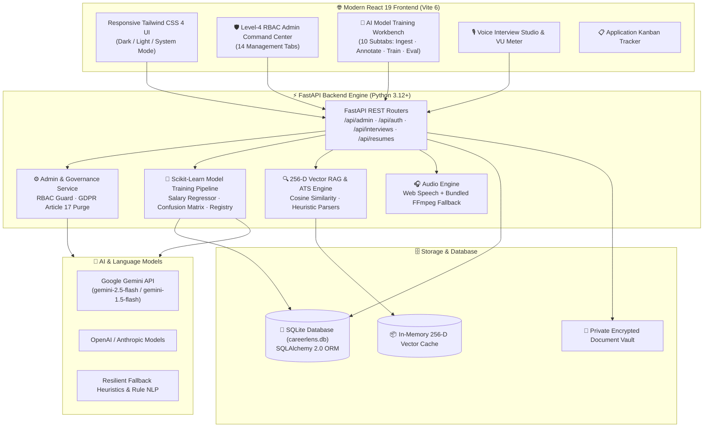

<div align="center">

<!-- Animated Header Wave Banner -->


<!-- Dynamic Animated Typing Subtitles -->
<a href="https://github.com/Isuru-CodeX/CareerLens">
  
</a>

<br/>

<!-- Modern Tech Stack & Quality Badges -->
<p align="center">
  
  
  
  
  
  
  
  
</p>

<p align="center">
  
  
  
  
  
  
  
  
</p>

<!-- Quick Link Buttons -->
<p align="center">
  <a href="#-about-careerlens-ai"><b>📱 About</b></a> •
  <a href="#-windows-desktop-application-mode"><b>🖥️ Desktop App</b></a> •
  <a href="#-enterprise-admin-command-center--ai-training-workbench"><b>🛡️ Admin Command Center</b></a> •
  <a href="#-in-app-ai-model-training-engine"><b>🧠 AI Model Training</b></a> •
  <a href="#-real-time-voice-mock-interviewer"><b>🎙️ Voice Interviewer</b></a> •
  <a href="#-54-role-career-trajectory-navigator"><b>🗺️ Career Navigator</b></a> •
  <a href="#-architecture"><b>🏗️ Architecture</b></a> •
  <a href="#-quick-start"><b>🚀 Quick Start</b></a> •
  <a href="#-test-suite--code-quality"><b>🧪 Testing</b></a>
</p>

</div>

---

## 📱 About CareerLens AI

**CareerLens AI** is an enterprise-grade, autonomous **career intelligence ecosystem and AI model training workbench**. Designed to bridge the gap between job candidates, algorithmic hiring systems (Applicant Tracking Systems), and talent operations, CareerLens AI provides an all-in-one suite spanning:

* 🛡️ **Level-4 RBAC Admin Command Center**: Comprehensive control room featuring 14 operations tabs and a dedicated 10-subtab AI Model Training Center.
* 🧠 **Autonomous AI Model Training Pipeline**: 1-click training, hyperparameter tuning, evaluation matrices, and hot-swappable model registries for compensation regressors and vector embeddings.
* 🎙️ **Voice AI Mock Interview Studio**: Interactive spoken interviews with real-time Web Audio API decibel metering, speech pacing (WPM), filler-word detection, and STAR rubric grading.
* 🗺️ **54-Role Career Knowledge Graph**: Directed graph spanning 8 major domains with Dijkstra shortest-path bridging and "My Current Profile" baseline benchmarking.
* 📑 **4-Tier ATS Stress-Test Engine**: Deep heuristic emulation across Workday, Greenhouse, Taleo, and Lever with explainable SHAP token attribution.
* 💰 **Market Salary Predictor & Offer Negotiation Coach**: Supervised compensation regression across 5 cost tiers paired with game-theory recruiter roleplay simulation.
* 🔒 **GDPR Article 17 Governance & Zero-PII Guarantee**: Instant machine-readable SAR export (.JSON) and cryptographic right-to-be-forgotten purges.

---

## 🖥️ Windows Desktop Application Mode

CareerLens AI can run as a **native Windows Desktop Application** without needing to open a web browser tab manually:

```
┌────────────────────────────────────────────────────────────────────────────────────────┐
│                        CareerLens AI - Windows Desktop App Shell                       │
├────────────────────────────────────────────────────────────────────────────┬───────────┤
│ 💼 CareerLens AI  •  Autonomous Career Intelligence Engine                 │ —  □  ✕   │
├────────────────────────────────────────────────────────────────────────────┴───────────┤
│  ✓ Standalone Native Windows App Window (No browser tabs or address bar)               │
│  ✓ Automatic Background Services Orchestration (FastAPI + React 19)                    │
│  ✓ High-Resolution Multi-Size Desktop Icon (careerlens.ico)                            │
│  ✓ Clean Window-Close Termination (Auto-kills backend processes, no zombie ports)      │
│  ✓ Pinned Windows Taskbar & Desktop Shortcut Integration (.lnk)                        │
└────────────────────────────────────────────────────────────────────────────────────────┘
```

### ⚡ 3 Ways to Run as a Windows Application:

#### 1️⃣ Desktop Shortcut (Double-Click from Windows Desktop)
A permanent desktop shortcut has been created at:
```text
C:\Users\<YourUsername>\Desktop\CareerLens AI.lnk
```
Simply double-click the **CareerLens AI** icon directly on your Windows desktop!
*(To regenerate the shortcut anytime, run `create_desktop_shortcut.bat`).*

#### 2️⃣ 1-Click Desktop Launcher (`run_desktop.bat`)
Double-click `run_desktop.bat` from the root directory or execute in PowerShell:
```powershell
.\run_desktop.ps1
```
* **What happens:** Boots FastAPI in hidden background mode, starts the React 19 UI server, verifies service health, and immediately opens CareerLens in a dedicated, distraction-free native desktop window ($1440 \times 920$). When you close the window, all background processes terminate automatically.

#### 3️⃣ Native Electron Desktop Shell (`npm run electron`)
You can also launch CareerLens directly inside the Electron desktop shell:
```bash
# Start desktop app via Electron
npm run electron

# Or launch development mode with live HMR
npm run desktop
```

---

---

## 🛡️ Enterprise Admin Command Center & AI Training Workbench

The **Admin Command Center** is a mission-control portal tailored for ML engineers, talent operators, and platform super-administrators:

```
┌────────────────────────────────────────────────────────────────────────────────────────┐
│                              CareerLens Admin Command Center                           │
├───────────────────┬───────────────────┬──────────────────────┬─────────────────────────┤
│ 1. AI Ops &       │ 2. Career &       │ 3. User & Access     │ 4. System &             │
│    Model Training │    Market Intel   │    Governance        │    Integrations         │
├───────────────────┼───────────────────┼──────────────────────┼─────────────────────────┤
│ • ML Training Hub │ • 54-Role Graph   │ • Level-4 RBAC       │ • System Health Monitor │
│ • 256-D Indexer   │ • Salary Tiers    │ • Masked PII Vault   │ • Real-Time Vector Ping │
│ • Prompt Sandbox  │ • ATS Filters     │ • GDPR Erasure (A17) │ • SQLite / Disk Storage │
│ • Token Spend     │ • Question Banks  │ • Immutable Audit    │ • Multi-Format Exporter │
└───────────────────┴───────────────────┴──────────────────────┴─────────────────────────┘
```

### 📋 Complete 14-Tab Command Center Breakdown:

| Tab | Module | Core Functionality & Capabilities |
|:---:|---|---|
| **01** | **Executive Dashboard** | Real-time platform KPI metrics, 7-day usage time-series analytics, vector latency ping, and rapid operational actions. |
| **02** | **Users & RBAC** | Role management across 6 tiers (`super_admin`, `admin`, `ml_engineer`, `reviewer`, `support`, `analyst`), temporary password resets (`CareerLensReset2026!`), and user account suspension/activation. |
| **03** | **Resumes Vault** | Centralized resume repository with parse status indicators (`parsed`, `warning`, `failed`), masked PII modals, and audited raw file downloads. |
| **04** | **Analysis Simulator** | Real-time ATS scoring simulator with live weight sliders (ATS, Impact, Brevity, Structure with 100% sum validation) and vague-phrase leaderboards. |
| **05** | **Job Matching Index** | Active job description catalog, match score distribution histograms, and percentile compensation calibration curves. |
| **06** | **Applications & Funnel** | 6-stage recruitment funnel cards and mock interview STAR performance analytics (**Situation 82%**, **Task 79.5%**, **Action 86.2%**, **Result 78%**). |
| **07** | **AI Model Training Center** | Complete 10-subtab machine learning lifecycle studio (detailed below). |
| **08** | **Knowledge Base** | 54-role career trajectory graph, skill synonym clustering, and language heuristic rule management. |
| **09** | **AI Prompts Playground** | System prompt template registry, locked guardrail badges, and interactive live model sandbox. |
| **10** | **Feedback & Support** | User feedback triage with a 1-click **"Convert to AI Mistake Report"** action for regression testing. |
| **11** | **Reports & CSV Exporter** | One-click verified CSV downloads for Users, Models, Resumes, and Audit Logs, alongside comprehensive Executive Audit Reports. |
| **12** | **Audit Ledger** | Append-only security audit trail recording actor IDs, roles, client IP addresses, and state modification diffs. |
| **13** | **Privacy & GDPR** | Consent donor statistics, automated training data isolation, and configurable retention schedules. |
| **14** | **System & Diagnostics** | Microservice health monitors, SQLite table sizes, parsed resume storage count, and live 256-D vector latency ping tests. |

---

## 🧠 In-App AI Model Training Engine

CareerLens AI features an integrated, end-to-end ML workbench built directly into the admin panel:

<div align="center">

```
   Raw Data Ingestion          Annotation & Curation          Training Pipeline           Evaluation & Gates          Production Registry
┌──────────────────────┐      ┌─────────────────────┐      ┌────────────────────┐      ┌─────────────────────┐      ┌─────────────────────┐
│ • User Resumes       │      │ • Segment Annotator │      │ • Scikit-Learn ML  │      │ • Confusion Matrix  │      │ • Staging / Prod    │
│ • Scraped JDs        │ ───► │ • Human Quality QA  │ ───► │ • Vector Embedder  │ ───► │ • Regression Scatter│ ───► │ • 1-Click Rollback  │
│ • Salary Snapshots   │      │ • Mistake Reviews   │      │ • Hyperparameters  │      │ • IR NDCG Benchmark │      │ • Hot-Swap Models   │
└──────────────────────┘      └─────────────────────┘      └────────────────────┘      └─────────────────────┘      └─────────────────────┘
```

</div>

### 🔬 The 10 Subtabs of the AI Training Center:
1. **Overview & Telemetry**: Live metrics on active models, labeled datasets, LLM token consumption, and IR benchmark performance ($\text{NDCG@3} \ge 0.9856$, $\text{Recall@5} = 1.0000$).
2. **Datasets Catalog**: Searchable repository of training corpora categorized by model family (*Salary, ATS Classifier, Vector Embeddings*).
3. **Manual Upload**: Drag-and-drop file ingestion with automatic train/validation/test split assignment (70/15/15).
4. **Online Import**: Secure external URL and dataset fetcher with built-in SSRF protection and schema validation.
5. **Annotation Workbench**: Interactive segment labeling tool allowing human evaluators to score resume bullet quality and skill relevance.
6. **Mistake Review & Regression Tests**: Review false-positive/false-negative predictions and convert them into permanent automated test assertions with 1 click.
7. **Training Jobs Launcher**: Launch background Scikit-Learn model training with live progress telemetry, epoch counters, and loss metrics.
8. **Evaluation Workbench**: Interactive confusion matrices, $R^2$ regression scatter plots, and MAE/RMSE calculation.
9. **Model Registry & Hot-Swapping**: Track staged vs. active production models with instant zero-downtime rollback capabilities.
10. **Auto-Learning Pipeline**: Configurable scheduled pipelines that automatically ingest verified feedback and trigger self-improvement loops.

---

## 🎙️ Real-Time Voice Mock Interviewer

<div align="center">


</div>

The **Voice AI Mock Interview Studio** simulates rigorous technical, behavioral, and executive hiring interviews inside the browser:

* **Spoken Question Synthesis**: The AI interviewer reads role-calibrated questions aloud using the Web Speech SpeechSynthesis API.
* **Dual-Channel Transcription**: Simultaneous in-browser live streaming speech recognition + native `MediaRecorder` audio capture with server-side bundled FFmpeg fallback.
* **Live Decibel VU Equalizer**: Visual 5-band sound equalizer rendered with the Web Audio API (`AnalyserNode`) providing active mic sensitivity (0–100%).
* **STAR Methodology Scoring**: Every spoken response is scored against Situation, Task, Action, and Result dimensions (0–100).
* **Verbal & Delivery Metrics**: Real-time Words-Per-Minute (WPM), speech cadence, and filler-word detection (*"um"*, *"like"*, *"basically"*, *"you know"*).
* **3-Pill Exemplar Model Answers**: Compare your answer against 3 benchmark scripts (*Executive Leadership & ROI*, *Deep Technical Architecture*, *Agile Incident Recovery*) with audio playback.
* **Computer Vision Coach**: Real-time webcam eye contact tracking, head pose posture estimation, and fidget cadence detection.

---

## 🗺️ 54-Role Career Trajectory Navigator

The **Career Knowledge Graph** models tech and product careers as a directed graph of 54 industry roles across 8 core domains:

```
┌────────────────────────────────────────────────────────────────────────────────────────┐
│                        54-Role Career Trajectory Knowledge Graph                       │
├───────────────────┬───────────────────┬──────────────────────┬─────────────────────────┤
│ Software Eng (8)  │ Data & AI (7)     │ Cloud & DevOps (6)   │ Cybersecurity (5)       │
│ • Full-Stack L1-L4│ • ML Engineer     │ • DevOps Specialist  │ • SecOps Analyst        │
│ • Systems Arch    │ • Data Scientist  │ • Cloud Architect    │ • Penetration Tester    │
├───────────────────┼───────────────────┼──────────────────────┼─────────────────────────┤
│ Product (6)       │ UI/UX Design (6)  │ Mobile Eng (6)       │ Enterprise Systems (10) │
│ • Technical PM    │ • Design Systems  │ • iOS / Android      │ • SAP / Salesforce Arch │
│ • Growth Lead     │ • UX Researcher   │ • Flutter / RN       │ • Solutions Architect   │
└───────────────────┴───────────────────┴──────────────────────┴─────────────────────────┘
```

* **Multi-Role Trajectory Comparator**: Compare 1 to 6 roles side-by-side with compensation bands, transition months, and prerequisite matrices.
* **"My Current Profile" Baseline**: One-click baseline comparison anchoring candidate skills against market demands.
* **Dijkstra Shortest-Path Bridging**: Calculates the mathematical shortest career bridge to reach any target seniority level with minimal skill gap friction.
* **Semantic Alignment Matrix**: $75\%$ skill alignment $+ 25\%$ experience tenure fit calculation.

---

## 💰 Salary Predictor & Offer Negotiation Coach

* **Calibrated Compensation Bands**: Predicts **25th (Entry)**, **50th (Median Market)**, **75th (Top Quartile)**, and **90th (Staff/Lead)** percentiles.
* **5 Global Location Tiers**: US Tier 1 (100%), US Tier 2 (88%), UK & Western Europe (76%), Canada & Australia (80%), APAC/Remote (65%).
* **High-ROI Skill Premiums**: Identifies top compensation drivers (*GenAI +14%, PyTorch +12%, Rust +11%, Kubernetes +8%*).
* **Game-Theory Recruiter Simulator**: Practice real-time negotiations with dynamic leverage scores, recruiter acceptance probability, and tactical feedback.
* **5 Battle-Tested Counter-Offers**: 1-click strategy scripts (*Market Data Anchor, Competing Offer, Total Comp Bridge, 6-Month Review, Phone Script*).

---

## 🏗️ Architecture



---

## 🛠️ Complete Tech Stack

<div align="center">


</div>

| Layer | Technologies | Purpose |
|---|---|---|
| **Frontend Framework** | React 19, TypeScript 5, Vite 6 | High-speed SPA, reactive hooks, sub-second HMR |
| **Styling & Icons** | Tailwind CSS 4, Lucide React, Framer Motion | Accessible themes, fluid layout transitions, micro-interactions |
| **Audio & Speech** | Web Audio API, Web Speech API, `MediaRecorder` | Real-time speech transcription, TTS voice synthesis, live VU meter |
| **Backend API** | Python 3.12+, FastAPI, Uvicorn, Pydantic v2 | High-performance asynchronous REST endpoints, strict typing |
| **Machine Learning** | Scikit-Learn, NumPy, SciPy | Supervised compensation regression, feature vectorization, evaluation |
| **Vector Search & RAG**| Custom 256-D Cosine Similarity Vector Engine | Fast semantic document matching and job-description retrieval |
| **Database & ORM** | SQLite, SQLAlchemy 2.0 | User profiles, audit logs, model registry, application records |
| **Audio Processing** | `imageio-ffmpeg` (bundled binary), `SpeechRecognition` | Server-side audio conversion and speech-to-text fallback |
| **Document Parsers** | `pypdf`, `python-docx`, `reportlab`, `beautifulsoup4` | Lossless extraction and generation of PDF/DOCX resumes |
| **AI LLM Inference** | Google Gemini API, OpenAI API, Anthropic Claude | Generative writing with zero-downtime heuristic rule fallbacks |
| **Testing & Quality** | `pytest`, `pytest-asyncio`, `respx`, `oxlint`, `tsc` | 32 automated tests, zero-warning linting, production build verification |

---

## 🚀 Quick Start

### ✅ System Prerequisites
* **Python**: 3.10+ (Python 3.12+ recommended)
* **Node.js**: v18+ (Node 20+ LTS recommended)
* **Git**

---

### 📥 1-Click Launch (Recommended for Windows)

The project includes automated scripts that set up the virtual environment, install dependencies, seed demo data, and start both the backend and frontend:

```powershell
# In PowerShell:
.\run_dev.ps1
```

Or double-click **`run_dev.bat`** from Windows File Explorer.

Once initialized:
* **Candidate Portal**: [http://localhost:5173](http://localhost:5173)
* **Admin Login Portal**: [http://localhost:5173](http://localhost:5173) $\rightarrow$ Profile $\rightarrow$ **Admin Command Center**
* **FastAPI Swagger Docs**: [http://localhost:8000/docs](http://localhost:8000/docs)

---

### 🔑 Verified Credentials Table

| Role | Email Address | Password | Access Level |
|:---:|:---:|:---:|:---:|
| **Super Admin** | `admin@careerlens.ai` | `admin123456` | Full Level-4 RBAC (AI Training, Database Purge, Prompts, Latency Tests) |
| **Demo Admin** | `demo@careerlens.ai` | `CareerLens2026!` | Master Admin Operations & Demo Account |

> **1-Click Login:** On the Admin Login page, click **"Super Admin"** or **"Demo Admin"** to autofill credentials instantly.

---

### 💻 Manual Step-by-Step Installation

#### 1️⃣ Clone the Repository
```bash
git clone https://github.com/Isuru-CodeX/CareerLens.git
cd CareerLens
```

#### 2️⃣ Backend Setup
```bash
cd backend
python -m venv venv

# Activate Virtual Environment
# Windows:
.\venv\Scripts\activate
# Linux/macOS:
source venv/bin/activate

# Install Dependencies
pip install -r requirements.txt

# Start Development Server
uvicorn app.main:app --host 127.0.0.1 --port 8000 --reload
```

#### 3️⃣ Frontend Setup
```bash
# In a separate terminal:
cd frontend

# Install Packages
npm install

# Start Vite Server
npm run dev
```

---

## 🧪 Test Suite & Code Quality

CareerLens AI enforces strict code quality and test coverage:

```bash
# 1️⃣ Run Backend Test Suite (32 Tests)
cd backend
.\venv\Scripts\pytest.exe tests/test_admin_spec.py tests/test_admin_ml.py tests/test_backend.py tests/test_matching_benchmark.py tests/test_vector_rag_and_ats.py -v

# 2️⃣ Verify Frontend Production TypeScript Build
npm --prefix frontend run build
```

```
======================= 32 passed, 1 warning in 12.89s =======================
✓ 2910 modules transformed.
✓ built in 747ms
```

---

## 🗺️ Completed Milestones & Roadmap

- [x] **Full-Stack ATS Resume Parser & Heuristic Scorer**
- [x] **Truth-Preserving AI Cover Letter Studio with NLP Refinements**
- [x] **Real-Time Voice AI Mock Interviewer with Spoken Audio Synthesis**
- [x] **Live 5-Band Web Audio Equalizer Meter (0–100% sensitivity feedback)**
- [x] **Native `MediaRecorder` + Bundled FFmpeg Server-Side Transcription**
- [x] **Drag-and-Drop Kanban Job Application Pipeline Tracker**
- [x] **Hybrid Semantic Search & 256-D Vector RAG Engine**
- [x] **4-Tier Enterprise ATS Stress-Test Engine (Workday, Greenhouse, Taleo, Lever)**
- [x] **54-Role Career Knowledge Graph with Dijkstra Shortest-Path Bridges**
- [x] **Market Salary Predictor & Interactive Offer Negotiation Coach**
- [x] **Explainable AI (SHAP) Token Heatmaps & Blind Recruitment Masking**
- [x] **Computer Vision Real-Time Webcam Eye-Contact & Posture Stability Coach**
- [x] **In-Browser Live Coding Sandbox with Algorithmic Big-O Complexity Review**
- [x] **GitHub "Proof of Work" Verifier with SHA-256 Signed Badges**
- [x] **Level-4 RBAC Admin Command Center with 14 Management Tabs**
- [x] **In-App AI Model Training Center with 10 ML Lifecycle Subtabs**
- [x] **Scikit-Learn Supervised Compensation Regressor Training Pipeline**
- [x] **Mistake Review & 1-Click Regression Test Generator**
- [x] **Model Registry with Staging Promotion Gates & Zero-Downtime Rollback**
- [x] **GDPR Article 17 Data Rights Machine-Readable SAR Export & Purges**
- [ ] Celery + Redis distributed background worker queue for enterprise multi-tenancy

---

## 📜 License

This project is licensed under the **MIT License** — feel free to explore, customize, and deploy it for your own career preparation or university programs.

---

<div align="center">

### 📬 Connect with the Developer

<a href="https://github.com/Isuru-CodeX">
  
</a>
<a href="https://www.linkedin.com/in/isuru-rathnayaka-220484288/">
  
</a>
<a href="mailto:isururathnayaka999@gmail.com">
  
</a>

<br/><br/>

⭐ **If you find CareerLens AI helpful, give it a star on GitHub!** ⭐

<br/>

<a href="#-about-careerlens-ai"><b>⬆️ Back to Top</b></a>

<br/><br/>

<!-- Animated Footer Wave Banner -->


</div>
