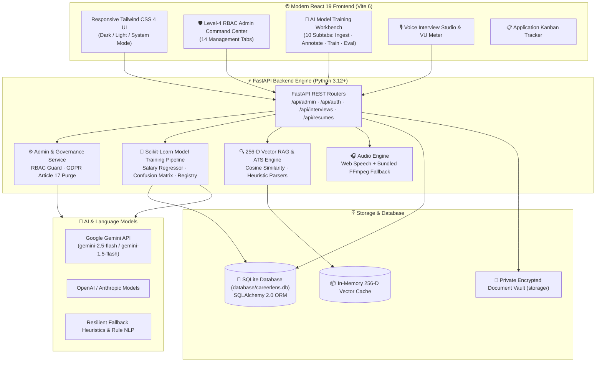

<div align="center">

<!-- Animated Header Wave Banner (Nexora Multi-Stop Gradient) -->


<!-- Project Brand Logo with Glowing Dropshadow -->
<p align="center">
  
</p>

<!-- Dynamic Animated Typing Subtitles -->
<a href="https://github.com/Isuru-CodeX/CareerLens">
  
</a>

<br/>

<!-- Modern Tech Stack & Quality Badges -->
<p align="center">
  
  
  
  
  
  
  
  
</p>

<p align="center">
  
  
  
  
  <a href="docs/README.md"></a>
  <a href="CODE_OF_CONDUCT.md"></a>
  <a href="SECURITY.md"></a>
  <a href="LICENSE"></a>
</p>

<!-- Quick Link Buttons -->
<p align="center">
  <a href="#-about-careerlens-ai"><b>📱 About</b></a> •
  <a href="#-windows-desktop-application-mode"><b>🖥️ Desktop App</b></a> •
  <a href="#-settings--configuration-hub"><b>⚙️ Settings & Config</b></a> •
  <a href="#-help-playbooks--diagnostics-suite"><b>📚 Help & Playbooks</b></a> •
  <a href="#-nexora-inspired-ui--motion-engine"><b>🎨 Nexora Motion</b></a> •
  <a href="#-enterprise-admin-command-center--ai-training-workbench"><b>🛡️ Admin Command Center</b></a> •
  <a href="#-in-app-ai-model-training-engine"><b>🧠 AI Model Training</b></a> •
  <a href="#-real-time-voice-mock-interviewer"><b>🎙️ Voice Interviewer</b></a> •
  <a href="#-54-role-career-trajectory-navigator"><b>🗺️ Career Navigator</b></a> •
  <a href="#-architecture"><b>🏗️ Architecture</b></a> •
  <a href="#-clean-project-directory-structure"><b>🗂️ Directory Layout</b></a> •
  <a href="docs/README.md"><b>📖 Tech Docs</b></a> •
  <a href="#-quick-start"><b>🚀 Quick Start</b></a> •
  <a href="#-governance-community--licensing"><b>📜 Governance & License</b></a>
</p>

</div>

---

## 📱 About CareerLens AI

**CareerLens AI** is an enterprise-grade, autonomous **career intelligence ecosystem and AI model training workbench**. Designed to bridge the gap between job candidates, algorithmic hiring systems (Applicant Tracking Systems), and talent operations, CareerLens AI provides an all-in-one suite spanning:

* 🛡️ **Level-4 RBAC Admin Command Center**: Comprehensive control room featuring 14 operations tabs and a dedicated 10-subtab AI Model Training Center.
* 🧠 **Autonomous AI Model Training Pipeline**: 1-click training, hyperparameter tuning, evaluation matrices, and hot-swappable model registries for compensation regressors and vector embeddings.
* 🎙️ **Voice AI Mock Interview Studio**: Interactive spoken interviews with real-time Web Audio API decibel metering, speech pacing (WPM), filler-word detection, and STAR rubric grading.
* 🗺️ **54-Role Career Knowledge Graph**: Directed graph spanning 8 major domains with Dijkstra shortest-path bridging and "My Current Profile" baseline benchmarking.
* 📑 **4-Tier ATS Stress-Test Engine**: Deep heuristic emulation across Workday, Greenhouse, Taleo, and Lever with explainable SHAP token attribution.
* 💰 **Market Salary Predictor & Offer Negotiation Coach**: Supervised compensation regression across 5 cost tiers paired with game-theory recruiter roleplay simulation.
* 🔒 **GDPR Article 17 Governance & Zero-PII Guarantee**: Instant machine-readable SAR export (.JSON) and cryptographic right-to-be-forgotten purges.

---

## 🖥️ Windows Desktop Application Mode

CareerLens AI can run as a **native Windows Desktop Application** without needing to open a web browser tab manually:

```
┌────────────────────────────────────────────────────────────────────────────────────────┐
│                        CareerLens AI - Windows Desktop App Shell                       │
├────────────────────────────────────────────────────────────────────────────┬───────────┤
│ 💼 CareerLens AI  •  Autonomous Career Intelligence Engine                 │ —  □  ✕   │
├────────────────────────────────────────────────────────────────────────────┴───────────┤
│  ✓ Standalone Native Windows App Window (No browser tabs or address bar)               │
│  ✓ Automatic Background Services Orchestration (FastAPI + React 19)                    │
│  ✓ High-Resolution Multi-Size Desktop Icon (careerlens.ico)                            │
│  ✓ Clean Window-Close Termination (Auto-kills backend processes, no zombie ports)      │
│  ✓ Pinned Windows Taskbar & Desktop Shortcut Integration (.lnk)                        │
└────────────────────────────────────────────────────────────────────────────────────────┘
```

### ⚡ 3 Ways to Run as a Windows Application:

#### 1️⃣ Desktop Shortcut (Double-Click from Windows Desktop)
A permanent desktop shortcut has been created at:
```text
C:\Users\<YourUsername>\Desktop\CareerLens AI.lnk
```
Simply double-click the **CareerLens AI** icon directly on your Windows desktop!
*(To regenerate the shortcut anytime, run `create_desktop_shortcut.bat`).*

#### 2️⃣ 1-Click Desktop Launcher (`run_desktop.bat`)
Double-click `run_desktop.bat` from the root directory or execute in PowerShell:
```powershell
# PowerShell:
.\scripts\run_desktop.ps1

# Or via npm:
npm run desktop
```
* **What happens:** Boots FastAPI in hidden background mode, starts the React 19 UI server, verifies service health, and immediately opens CareerLens in a dedicated, distraction-free native desktop window ($1440 \times 920$). When you close the window, all background processes terminate automatically.

#### 3️⃣ Native Electron Desktop Shell (`npm run electron`)
You can also launch CareerLens directly inside the Electron desktop shell:
```bash
# Start desktop app via Electron
npm run electron

# Or launch development mode with live HMR
npm run desktop
```

#### 🛑 Clean Termination Anytime (`stop_desktop.bat`)
To instantly terminate all running background background servers, workers, and browser instances:
```powershell
# In PowerShell:
.\scripts\stop_desktop.ps1

# Or via npm:
npm run stop
```

---

## ⚙️ Settings & Configuration Hub

The **Settings & Configuration Hub** (`Alt + S`) provides fine-grained control over AI inference parameters, scoring heuristic calibrations, desktop animation aesthetics, cache telemetry, and user privacy:

```
┌──────────────────────────────────────────────────────────────────────────────────────────────────┐
│                                 CareerLens AI Settings & Configuration Hub                        │
├──────────────────────┬──────────────────────┬──────────────────────┬─────────────────────────────┤
│ 1. AI & Models       │ 2. ATS Calibration   │ 3. Desktop & UI      │ 4. Storage & Privacy        │
├──────────────────────┼──────────────────────┼──────────────────────┼─────────────────────────────┤
│ • Provider Selector  │ • Strictness Presets │ • Appearance Theme   │ • Live SQLite Telemetry     │
│ • Custom Model ID    │ • 4 Weight Sliders   │ • Animation Level    │ • 1-Click Transient Cache   │
│ • Masked API Keys    │ • 100% Sum Lock      │ • Top Route Loader   │ • Machine-Readable SAR JSON │
│ • Live Ping Latency  │ • Blind DEI Masking  │ • Audio Chimes & Vol │ • GDPR Article 17 Erasure   │
└──────────────────────┴──────────────────────┴──────────────────────┴─────────────────────────────┘
```

### 🎛️ 5 Configuration Categories:

1. **🧠 AI & Inference Models:**
   * **Multi-Provider Architecture:** Hot-swap between **Google Gemini** (`gemini-2.5-flash`, `gemini-1.5-pro`), **OpenAI** (`gpt-4o`, `gpt-4o-mini`), **Anthropic Claude** (`claude-3-5-sonnet`), and offline deterministic heuristic rules.
   * **Inference Sliders:** Calibrate response temperature ($0.0 \leftrightarrow 1.0$) and max completion token budgets ($512 \leftrightarrow 8192$).
   * **Security:** API keys are stored in secure local storage and masked with instant toggle visibility.
   * **Live Diagnostics:** Run real-time latency ping tests against the FastAPI backend directly from the UI.

2. **⚖️ ATS & Scoring Calibration:**
   * **Industry Strictness Presets:** Choose from **Permissive** (Startup/Creative, 65 baseline), **Balanced** (Mid-Market, 75 baseline), or **Strict** (FAANG/Fortune 50, 85 baseline).
   * **4-Way Weight Balancer:** Adjust the relative weights of **ATS Format**, **Quantified Impact**, **Brevity & Conciseness**, and **Structure** with real-time $100\%$ sum validation.
   * **DEI Blind Recruitment Mode:** Automatically strips candidate name, email, phone, location, and graduation year before processing to ensure unbiased evaluation.

3. **🎨 Desktop & Interface Customization:**
   * **Triple Appearance Sync:** Full support for **Dark Mode**, **Light Mode**, and **System OS Synchronization**.
   * **Framer Motion Animation Levels:** Select between **Full Motion** (smooth layout transitions), **Balanced**, or **Minimal / Reduced Motion**.
   * **Nexora Glowing Top Route Stream:** Toggleable 3px top progress loader bar with multi-stop cyan-to-fuchsia gradients.
   * **Audio Cue Chimes:** Sound effects for completed resume audits, interview audio recording triggers, and ATS score updates.

4. **💾 Storage, Cache & Data Telemetry:**
   * **Live Database Telemetry:** Displays real-time SQLite database file size, WAL journal mode status, table row counts, and disk path.
   * **1-Click Cache Purge:** Clears session state and transient resume cache without affecting persistent user account data.
   * **Full JSON SAR Backup:** Download your complete candidate profile, resumes, interview logs, and custom weights into a machine-readable JSON file.

5. **🔒 Security & GDPR Rights:**
   * **GDPR Article 17 Right to Erasure:** Cryptographically purges all candidate data, resumes, voice recordings, and audit logs.
   * **Zero-PII Storage Policy:** Local vector embeddings and encrypted storage ensure data remains strictly private.

---

## 📚 Help, Resource Playbooks & Diagnostics Suite

The **Help & Knowledge Hub** (`Alt + H`) delivers an end-to-end acceleration manual, industry interview masterclass, and real-time audio/microphone hardware self-test suite:

```
┌──────────────────────────────────────────────────────────────────────────────────────────────────┐
│                                CareerLens Help & Resource Playbook Suite                         │
├──────────────────────┬──────────────────────┬──────────────────────┬─────────────────────────────┤
│ 📖 User Playbook     │ 🎯 ATS Playbook      │ 🎙️ STAR Masterclass  │ 🛠️ Diagnostics Suite       │
├──────────────────────┼──────────────────────┼──────────────────────┼─────────────────────────────┤
│ • 5-Stage Fast-Track │ • Do's vs Don'ts     │ • 15/15/45/25 Ratio  │ • Web Audio Mic VU Meter    │
│ • Resume Upload Flow │ • Keyword Density    │ • 120-150 WPM Target │ • FastAPI Ping Monitor      │
│ • Job Vector Match   │ • Formatting Traps   │ • Listen to Exemplar │ • Speech Synthesis Test     │
│ • Direct Deep Links  │ • PDF vs Word Heur.  │ • Metric Framing     │ • Ticket Help Desk Form     │
└──────────────────────┴──────────────────────┴──────────────────────┴─────────────────────────────┘
```

### 🌟 Interactive Diagnostics & Self-Test Suite:

* **🎙️ Live Web Audio Microphone VU Meter:** Connects to your native input device via the browser Web Audio API, calculating root-mean-square (RMS) decibel volume in real time with an animated color-coded visual indicator.
* **🔊 Spoken Speech Synthesis Self-Test:** Tests your operating system's Web Speech API text-to-speech audio playback so you never enter a mock interview without sound verification.
* **⚡ FastAPI Dual Ping Check:** Verifies that both the backend server (`http://127.0.0.1:8000/health`) and the Vite reverse proxy (`/api/health`) are responding with sub-millisecond latency.
* **🗄️ Database Integrity Audit:** Queries SQLite WAL journal status and reports instantaneous query response time.

### ⌨️ Universal Keyboard Shortcut Matrix:

| Shortcut | Destination View | Function |
|:---:|:---:|---|
| <kbd>Alt</kbd> + <kbd>D</kbd> | **Dashboard** | Executive candidate overview & pipeline metrics |
| <kbd>Alt</kbd> + <kbd>R</kbd> | **Resume Library** | Upload, audit, and compare resume versions |
| <kbd>Alt</kbd> + <kbd>M</kbd> | **Job Matcher** | Vector similarity job matching & keyword gaps |
| <kbd>Alt</kbd> + <kbd>C</kbd> | **Career Navigator** | 54-role directed graph & salary explorer |
| <kbd>Alt</kbd> + <kbd>A</kbd> | **AI Studio** | Voice mock interviewer & XYZ bullet rewriter |
| <kbd>Alt</kbd> + <kbd>K</kbd> | **Applications** | Drag-and-drop Kanban job application board |
| <kbd>Alt</kbd> + <kbd>P</kbd> | **Profile** | Candidate preferences, target salary & skills |
| <kbd>Alt</kbd> + <kbd>L</kbd> | **Activity** | Live audit event streaming & security ledger |
| <kbd>Alt</kbd> + <kbd>S</kbd> | **Settings & Config** | AI models, ATS weights & desktop appearance |
| <kbd>Alt</kbd> + <kbd>H</kbd> | **Help & Playbooks** | Playbooks, interview guides & hardware tests |

---

## 🎨 Nexora-Inspired Fluid UI & Motion Engine

Following the design system and motion language of **[Nexora](https://github.com/Isuru-CodeX/Nexora)**, CareerLens AI incorporates an ultra-modern, high-polish visual experience:

* 🌊 **Glowing Top Route Progress Stream:** A 3-pixel animated loader (`#careerlens-top-loader`) that sweeps across the screen on every route change with a vibrant multi-stop gradient (`#01C7F4` Cyan $\rightarrow$ `#6366F1` Indigo $\rightarrow$ `#A855F7` Purple $\rightarrow$ `#D803B3` Fuchsia).
* 🔮 **Ambient Floating Glow Orbs:** Subtle, hardware-accelerated background radial blurs (`blur-3xl`) that drift in the background to provide deep glassmorphic contrast without impacting rendering performance.
* ⚡ **Framer Motion Route Transitions:** Instant, spring-eased layout transitions (`y: 10` $\rightarrow$ `y: 0`, duration 220ms) that prevent harsh layout jumps and make every screen transition feel native and fluid.
* 🪟 **Glassmorphism & Micro-Interactions:** Frosted glass navigation bars (`backdrop-blur-md`), hover-activated elevation scales, and glowing active indicator pills.

---

## 🛡️ Enterprise Admin Command Center & AI Training Workbench

The **Admin Command Center** is a mission-control portal tailored for ML engineers, talent operators, and platform super-administrators:

```
┌────────────────────────────────────────────────────────────────────────────────────────┐
│                              CareerLens Admin Command Center                           │
├───────────────────┬───────────────────┬──────────────────────┬─────────────────────────┤
│ 1. AI Ops &       │ 2. Career &       │ 3. User & Access     │ 4. System &             │
│    Model Training │    Market Intel   │    Governance        │    Integrations         │
├───────────────────┼───────────────────┼──────────────────────┼─────────────────────────┤
│ • ML Training Hub │ • 54-Role Graph   │ • Level-4 RBAC       │ • System Health Monitor │
│ • 256-D Indexer   │ • Salary Tiers    │ • Masked PII Vault   │ • Real-Time Vector Ping │
│ • Prompt Sandbox  │ • ATS Filters     │ • GDPR Erasure (A17) │ • SQLite / Disk Storage │
│ • Token Spend     │ • Question Banks  │ • Immutable Audit    │ • Multi-Format Exporter │
└───────────────────┴───────────────────┴──────────────────────┴─────────────────────────┘
```

### 📋 Complete 14-Tab Command Center Breakdown:

| Tab | Module | Core Functionality & Capabilities |
|:---:|---|---|
| **01** | **Executive Dashboard** | Real-time platform KPI metrics, 7-day usage time-series analytics, vector latency ping, and rapid operational actions. |
| **02** | **Users & RBAC** | Role management across 6 tiers (`super_admin`, `admin`, `ml_engineer`, `reviewer`, `support`, `analyst`), temporary password resets (`CareerLensReset2026!`), and user account suspension/activation. |
| **03** | **Resumes Vault** | Centralized resume repository with parse status indicators (`parsed`, `warning`, `failed`), masked PII modals, and audited raw file downloads. |
| **04** | **Analysis Simulator** | Real-time ATS scoring simulator with live weight sliders (ATS, Impact, Brevity, Structure with 100% sum validation) and vague-phrase leaderboards. |
| **05** | **Job Matching Index** | Active job description catalog, match score distribution histograms, and percentile compensation calibration curves. |
| **06** | **Applications & Funnel** | 6-stage recruitment funnel cards and mock interview STAR performance analytics (**Situation 82%**, **Task 79.5%**, **Action 86.2%**, **Result 78%**). |
| **07** | **AI Model Training Center** | Complete 10-subtab machine learning lifecycle studio (detailed below). |
| **08** | **Knowledge Base** | 54-role career trajectory graph, skill synonym clustering, and language heuristic rule management. |
| **09** | **AI Prompts Playground** | System prompt template registry, locked guardrail badges, and interactive live model sandbox. |
| **10** | **Feedback & Support** | User feedback triage with a 1-click **"Convert to AI Mistake Report"** action for regression testing. |
| **11** | **Reports & CSV Exporter** | One-click verified CSV downloads for Users, Models, Resumes, and Audit Logs, alongside comprehensive Executive Audit Reports. |
| **12** | **Audit Ledger** | Append-only security audit trail recording actor IDs, roles, client IP addresses, and state modification diffs. |
| **13** | **Privacy & GDPR** | Consent donor statistics, automated training data isolation, and configurable retention schedules. |
| **14** | **System & Diagnostics** | Microservice health monitors, SQLite table sizes, parsed resume storage count, and live 256-D vector latency ping tests. |

---

## 🧠 In-App AI Model Training Engine

CareerLens AI features an integrated, end-to-end ML workbench built directly into the admin panel:

<div align="center">

```
   Raw Data Ingestion          Annotation & Curation          Training Pipeline           Evaluation & Gates          Production Registry
┌──────────────────────┐      ┌─────────────────────┐      ┌────────────────────┐      ┌─────────────────────┐      ┌─────────────────────┐
│ • User Resumes       │      │ • Segment Annotator │      │ • Scikit-Learn ML  │      │ • Confusion Matrix  │      │ • Staging / Prod    │
│ • Scraped JDs        │ ───► │ • Human Quality QA  │ ───► │ • Vector Embedder  │ ───► │ • Regression Scatter│ ───► │ • 1-Click Rollback  │
│ • Salary Snapshots   │      │ • Mistake Reviews   │      │ • Hyperparameters  │      │ • IR NDCG Benchmark │      │ • Hot-Swap Models   │
└──────────────────────┘      └─────────────────────┘      └────────────────────┘      └─────────────────────┘      └─────────────────────┘
```

</div>

### 🔬 The 10 Subtabs of the AI Training Center:
1. **Overview & Telemetry**: Live metrics on active models, labeled datasets, LLM token consumption, and IR benchmark performance ($\text{NDCG@3} \ge 0.9856$, $\text{Recall@5} = 1.0000$).
2. **Datasets Catalog**: Searchable repository of training corpora categorized by model family (*Salary, ATS Classifier, Vector Embeddings*).
3. **Manual Upload**: Drag-and-drop file ingestion with automatic train/validation/test split assignment (70/15/15).
4. **Online Import**: Secure external URL and dataset fetcher with built-in SSRF protection and schema validation.
5. **Annotation Workbench**: Interactive segment labeling tool allowing human evaluators to score resume bullet quality and skill relevance.
6. **Mistake Review & Regression Tests**: Review false-positive/false-negative predictions and convert them into permanent automated test assertions with 1 click.
7. **Training Jobs Launcher**: Launch background Scikit-Learn model training with live progress telemetry, epoch counters, and loss metrics.
8. **Evaluation Workbench**: Interactive confusion matrices, $R^2$ regression scatter plots, and MAE/RMSE calculation.
9. **Model Registry & Hot-Swapping**: Track staged vs. active production models with instant zero-downtime rollback capabilities.
10. **Auto-Learning Pipeline**: Configurable scheduled pipelines that automatically ingest verified feedback and trigger self-improvement loops.

---

## 🎙️ Real-Time Voice Mock Interviewer

<div align="center">


</div>

The **Voice AI Mock Interview Studio** simulates rigorous technical, behavioral, and executive hiring interviews inside the browser:

* **Spoken Question Synthesis**: The AI interviewer reads role-calibrated questions aloud using the Web Speech SpeechSynthesis API.
* **Dual-Channel Transcription**: Simultaneous in-browser live streaming speech recognition + native `MediaRecorder` audio capture with server-side bundled FFmpeg fallback.
* **Live Decibel VU Equalizer**: Visual 5-band sound equalizer rendered with the Web Audio API (`AnalyserNode`) providing active mic sensitivity (0–100%).
* **STAR Methodology Scoring**: Every spoken response is scored against Situation, Task, Action, and Result dimensions (0–100).
* **Verbal & Delivery Metrics**: Real-time Words-Per-Minute (WPM), speech cadence, and filler-word detection (*"um"*, *"like"*, *"basically"*, *"you know"*).
* **3-Pill Exemplar Model Answers**: Compare your answer against 3 benchmark scripts (*Executive Leadership & ROI*, *Deep Technical Architecture*, *Agile Incident Recovery*) with audio playback.
* **Computer Vision Coach**: Real-time webcam eye contact tracking, head pose posture estimation, and fidget cadence detection.

---

## 🗺️ 54-Role Career Trajectory Navigator

The **Career Knowledge Graph** models tech and product careers as a directed graph of 54 industry roles across 8 core domains:

```
┌────────────────────────────────────────────────────────────────────────────────────────┐
│                        54-Role Career Trajectory Knowledge Graph                       │
├───────────────────┬───────────────────┬──────────────────────┬─────────────────────────┤
│ Software Eng (8)  │ Data & AI (7)     │ Cloud & DevOps (6)   │ Cybersecurity (5)       │
│ • Full-Stack L1-L4│ • ML Engineer     │ • DevOps Specialist  │ • SecOps Analyst        │
│ • Systems Arch    │ • Data Scientist  │ • Cloud Architect    │ • Penetration Tester    │
├───────────────────┼───────────────────┼──────────────────────┼─────────────────────────┤
│ Product (6)       │ UI/UX Design (6)  │ Mobile Eng (6)       │ Enterprise Systems (10) │
│ • Technical PM    │ • Design Systems  │ • iOS / Android      │ • SAP / Salesforce Arch │
│ • Growth Lead     │ • UX Researcher   │ • Flutter / RN       │ • Solutions Architect   │
└───────────────────┴───────────────────┴──────────────────────┴─────────────────────────┘
```

* **Multi-Role Trajectory Comparator**: Compare 1 to 6 roles side-by-side with compensation bands, transition months, and prerequisite matrices.
* **"My Current Profile" Baseline**: One-click baseline comparison anchoring candidate skills against market demands.
* **Dijkstra Shortest-Path Bridging**: Calculates the mathematical shortest career bridge to reach any target seniority level with minimal skill gap friction.
* **Semantic Alignment Matrix**: $75\%$ skill alignment $+ 25\%$ experience tenure fit calculation.

---

## 💰 Salary Predictor & Offer Negotiation Coach

* **Calibrated Compensation Bands**: Predicts **25th (Entry)**, **50th (Median Market)**, **75th (Top Quartile)**, and **90th (Staff/Lead)** percentiles.
* **5 Global Location Tiers**: US Tier 1 (100%), US Tier 2 (88%), UK & Western Europe (76%), Canada & Australia (80%), APAC/Remote (65%).
* **High-ROI Skill Premiums**: Identifies top compensation drivers (*GenAI +14%, PyTorch +12%, Rust +11%, Kubernetes +8%*).
* **Game-Theory Recruiter Simulator**: Practice real-time negotiations with dynamic leverage scores, recruiter acceptance probability, and tactical feedback.
* **5 Battle-Tested Counter-Offers**: 1-click strategy scripts (*Market Data Anchor, Competing Offer, Total Comp Bridge, 6-Month Review, Phone Script*).

---

## 🏗️ Architecture



---

## 🛠️ Complete Tech Stack

<div align="center">


</div>

| Layer | Technologies | Purpose |
|---|---|---|
| **Frontend Framework** | React 19, TypeScript 5, Vite 6 | High-speed SPA, reactive hooks, sub-second HMR |
| **Styling & Icons** | Tailwind CSS 4, Lucide React, Framer Motion | Accessible themes, fluid layout transitions, micro-interactions |
| **Audio & Speech** | Web Audio API, Web Speech API, `MediaRecorder` | Real-time speech transcription, TTS voice synthesis, live VU meter |
| **Backend API** | Python 3.12+, FastAPI, Uvicorn, Pydantic v2 | High-performance asynchronous REST endpoints, strict typing |
| **Machine Learning** | Scikit-Learn, NumPy, SciPy | Supervised compensation regression, feature vectorization, evaluation |
| **Vector Search & RAG**| Custom 256-D Cosine Similarity Vector Engine | Fast semantic document matching and job-description retrieval |
| **Database & ORM** | SQLite, SQLAlchemy 2.0 | User profiles, audit logs, model registry, application records |
| **Audio Processing** | `imageio-ffmpeg` (bundled binary), `SpeechRecognition` | Server-side audio conversion and speech-to-text fallback |
| **Document Parsers** | `pypdf`, `python-docx`, `reportlab`, `beautifulsoup4` | Lossless extraction and generation of PDF/DOCX resumes |
| **AI LLM Inference** | Google Gemini API, OpenAI API, Anthropic Claude | Generative writing with zero-downtime heuristic rule fallbacks |
| **Testing & Quality** | `pytest`, `pytest-asyncio`, `respx`, `oxlint`, `tsc` | 32 automated tests, zero-warning linting, production build verification |

---

## 🚀 Quick Start

### ✅ System Prerequisites
* **Python**: 3.10+ (Python 3.12+ recommended)
* **Node.js**: v18+ (Node 20+ LTS recommended)
* **Git**

---

### 📥 1-Click Launch (Recommended for Windows)

The project includes automated scripts that set up the virtual environment, install dependencies, seed demo data, and start both the backend and frontend:

```powershell
# In PowerShell:
.\scripts\run_dev.ps1

# Or via npm:
npm run dev
```

Or double-click **`run_dev.bat`** from Windows File Explorer.

Once initialized:
* **Candidate Portal**: [http://localhost:5173](http://localhost:5173)
* **Admin Login Portal**: [http://localhost:5173](http://localhost:5173) $\rightarrow$ Profile $\rightarrow$ **Admin Command Center**
* **FastAPI Swagger Docs**: [http://localhost:8000/docs](http://localhost:8000/docs)

---

## 🗂️ Clean Project Directory Structure

The project has been organized with clean separation of concerns, ensuring database files, logs, documentation, scripts, and media storage reside in their dedicated directories:

```text
CareerLens/
├── backend/                    # FastAPI REST application & ML training pipelines
│   ├── app/                    # API routers, core configuration & SQLAlchemy models
│   ├── ml_artifacts/           # Trained Scikit-Learn weights (score_calibrator.joblib)
│   ├── tests/                  # Pytest unit & integration test suites
│   └── requirements.txt        # Python backend package dependencies
├── database/                   # SQLite database & data persistence
│   ├── careerlens.db           # Canonical SQLite database file (WAL mode)
│   ├── migrations/             # Schema migration scripts
│   └── seed-data/              # Seed fixtures (Alex Rivera demo user & initial jobs)
├── docs/                       # Comprehensive Technical Documentation Hub
│   ├── README.md               # Documentation library index & table of contents
│   ├── API_DOCUMENTATION.md    # REST API specification & schemas
│   ├── ARCHITECTURE.md         # Microservice & frontend architectural design
│   ├── DATABASE_DESIGN.md      # Relational entity models, tables & indexes
│   ├── DEPLOYMENT.md           # Production deployment & Docker containers
│   ├── PROJECT_REQUIREMENTS.md # Functional requirements & acceptance criteria
│   ├── SECURITY.md             # Level-4 RBAC rules & GDPR Article 17 protocols
│   ├── TESTING.md              # Test matrix & IR benchmark specifications
│   ├── UI_UX_GUIDELINES.md     # Design tokens, typography & WCAG 2.1 rules
│   ├── diagrams/               # Architectural sequence & entity relationship diagrams
│   └── screenshots/            # Feature previews and UI showcases
├── electron/                   # Native Electron desktop application wrapper
├── extension/                  # Chrome extension companion for 1-click job parsing
├── frontend/                   # React 19 + TypeScript + Vite + Tailwind CSS SPA
│   ├── src/                    # Components, views, services & state contexts
│   └── package.json            # Frontend dependencies & build commands
├── logs/                       # Application runtime, diagnostic & process logs
│   ├── backend_desktop.log     # Background FastAPI service log
│   └── .gitkeep                # Git tracking keeper (logs gitignored)
├── scripts/                    # Automation & process management PowerShell scripts
│   ├── run_desktop.ps1         # Windows desktop app orchestrator & port allocator
│   ├── stop_desktop.ps1        # 1-click clean background process termination
│   ├── run_dev.ps1             # Local development server launcher
│   └── create_desktop_shortcut.ps1 # Windows Desktop shortcut (.lnk) generator
├── storage/                    # Uploaded candidate resumes, avatars, and audio records
├── package.json                # Root workspace configuration & unified npm scripts
├── run_desktop.bat             # 1-click desktop double-click launcher
├── stop_desktop.bat            # 1-click stop double-click script
├── run_dev.bat                 # 1-click dev server launcher
├── create_desktop_shortcut.bat # 1-click shortcut generator
└── README.md                   # Master project README
```

---

### 🔑 Verified Credentials Table

| Role | Email Address | Password | Access Level |
|:---:|:---:|:---:|:---:|
| **Super Admin** | `admin@careerlens.ai` | `admin123456` | Full Level-4 RBAC (AI Training, Database Purge, Prompts, Latency Tests) |
| **Demo Admin** | `demo@careerlens.ai` | `CareerLens2026!` | Master Admin Operations & Demo Account |

> **1-Click Login:** On the Admin Login page, click **"Super Admin"** or **"Demo Admin"** to autofill credentials instantly.

---

### 💻 Manual Step-by-Step Installation

#### 1️⃣ Clone the Repository
```bash
git clone https://github.com/Isuru-CodeX/CareerLens.git
cd CareerLens
```

#### 2️⃣ Backend Setup
```bash
cd backend
python -m venv venv

# Activate Virtual Environment
# Windows:
.\venv\Scripts\activate
# Linux/macOS:
source venv/bin/activate

# Install Dependencies
pip install -r requirements.txt

# Start Development Server
uvicorn app.main:app --host 127.0.0.1 --port 8000 --reload
```

#### 3️⃣ Frontend Setup
```bash
# In a separate terminal:
cd frontend

# Install Packages
npm install

# Start Vite Server
npm run dev
```

---

## 🧪 Test Suite & Code Quality

CareerLens AI enforces strict code quality and test coverage:

```bash
# 1️⃣ Run Backend Test Suite (32 Tests)
cd backend
.\venv\Scripts\pytest.exe tests/test_admin_spec.py tests/test_admin_ml.py tests/test_backend.py tests/test_matching_benchmark.py tests/test_vector_rag_and_ats.py -v

# 2️⃣ Verify Frontend Production TypeScript Build
npm --prefix frontend run build
```

```
======================= 32 passed, 1 warning in 12.89s =======================
✓ 2910 modules transformed.
✓ built in 747ms
```

---

## 🗺️ Completed Milestones & Roadmap

- [x] **Full-Stack ATS Resume Parser & Heuristic Scorer**
- [x] **Truth-Preserving AI Cover Letter Studio with NLP Refinements**
- [x] **Real-Time Voice AI Mock Interviewer with Spoken Audio Synthesis**
- [x] **Live 5-Band Web Audio Equalizer Meter (0–100% sensitivity feedback)**
- [x] **Native `MediaRecorder` + Bundled FFmpeg Server-Side Transcription**
- [x] **Drag-and-Drop Kanban Job Application Pipeline Tracker**
- [x] **Hybrid Semantic Search & 256-D Vector RAG Engine**
- [x] **4-Tier Enterprise ATS Stress-Test Engine (Workday, Greenhouse, Taleo, Lever)**
- [x] **54-Role Career Knowledge Graph with Dijkstra Shortest-Path Bridges**
- [x] **Market Salary Predictor & Interactive Offer Negotiation Coach**
- [x] **Explainable AI (SHAP) Token Heatmaps & Blind Recruitment Masking**
- [x] **Computer Vision Real-Time Webcam Eye-Contact & Posture Stability Coach**
- [x] **In-Browser Live Coding Sandbox with Algorithmic Big-O Complexity Review**
- [x] **GitHub "Proof of Work" Verifier with SHA-256 Signed Badges**
- [x] **Level-4 RBAC Admin Command Center with 14 Management Tabs**
- [x] **In-App AI Model Training Center with 10 ML Lifecycle Subtabs**
- [x] **Scikit-Learn Supervised Compensation Regressor Training Pipeline**
- [x] **Mistake Review & 1-Click Regression Test Generator**
- [x] **Model Registry with Staging Promotion Gates & Zero-Downtime Rollback**
- [x] **GDPR Article 17 Data Rights Machine-Readable SAR Export & Purges**
- [x] **Settings & Configuration Hub with Multi-LLM Provider & ATS Strictness Tuning**
- [x] **Help & Knowledge Hub with Interactive Audio VU Meter Hardware Self-Test**
- [x] **Nexora-Inspired UI with Top Glowing Route Stream & Ambient Glow Orbs**
- [x] **Universal Keyboard Shortcut Engine (Alt+D, R, M, C, A, K, P, L, S, H)**
- [ ] Celery + Redis distributed background worker queue for enterprise multi-tenancy

---

## 📜 Governance, Community & Licensing

CareerLens AI is an open-source initiative designed for candidates, universities, and enterprise talent teams. We adhere to transparent governance and welcoming community standards:

| Document | Focus & Scope | Description |
|:---:|---|---|
| **[📜 MIT License](LICENSE)** | **Open-Source License** | Permissive MIT License covering all source code, ML wrappers, and frontend views. Free for commercial and non-commercial adoption. |
| **[🤝 Code of Conduct](CODE_OF_CONDUCT.md)** | **Community Standards** | Contributor Covenant v2.1 commitment to a safe, welcoming, and harassment-free experience for everyone. |
| **[🔒 Security Policy](SECURITY.md)** | **Vulnerability Reporting** | SLA response protocols, responsible disclosure guidelines, and active maintenance matrix. |
| **[🛡️ Threat Model Architecture](docs/SECURITY.md)** | **Data Protection Specs** | In-depth breakdown of multi-tenant data isolation, salted bcrypt encryption, and zero-PII extraction. |
| **[📚 Technical Docs Hub](docs/README.md)** | **Complete Documentation** | Full architectural guides, REST API endpoints, database schemas, and testing matrices. |

---

<div align="center">

<!-- Project Brand Logo in Footer -->
<p align="center">
  
</p>

### 📬 Connect with the Developer

<a href="https://github.com/Isuru-CodeX">
  
</a>
<a href="https://www.linkedin.com/in/isuru-rathnayaka-220484288/">
  
</a>
<a href="mailto:isururathnayaka999@gmail.com">
  
</a>

<br/><br/>

⭐ **If you find CareerLens AI helpful, give it a star on GitHub!** ⭐

<br/>

<a href="#-about-careerlens-ai"><b>⬆️ Back to Top</b></a>

<br/><br/>

<!-- Animated Footer Wave Banner (Nexora Multi-Stop Gradient) -->


</div>
