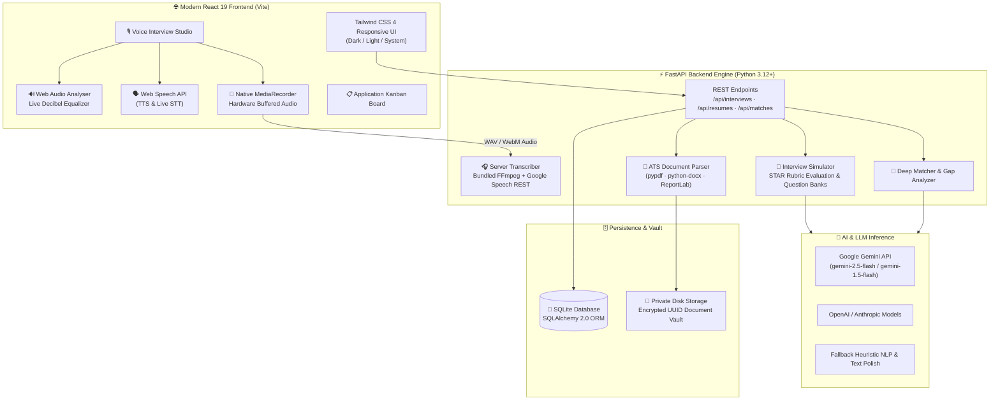

<div align="center">


<a href="https://github.com/Isuru-CodeX/CareerLens">
  
</a>

<br/>

<p>
  
  
  
  
  
  
  
</p>

<p>
  
  
  
  
  
</p>

<p>
  <a href="#-about"><b>📱 About</b></a> •
  <a href="#-features"><b>✨ Features</b></a> •
  <a href="#-real-time-voice-mock-interviewer"><b>🎙️ Voice Interviewer</b></a> •
  <a href="#-54-role-career-trajectory-comparator--knowledge-graph"><b>🗺️ Career Navigator</b></a> •
  <a href="#-architecture"><b>🏗️ Architecture</b></a> •
  <a href="#-tech-stack"><b>🛠️ Tech Stack</b></a> •
  <a href="#-getting-started"><b>🚀 Quick Start</b></a> •
  <a href="#-testing--code-quality"><b>🧪 Testing</b></a> •
  <a href="#-roadmap"><b>🗺️ Roadmap</b></a>
</p>

</div>

---

## 📱 About

**CareerLens AI** is an enterprise-grade, autonomous **career intelligence and resume elevation platform**. Designed to bridge the gap between job candidates and modern Applicant Tracking Systems (ATS), CareerLens AI moves beyond basic static forms by combining **heuristic ATS parsing, semantic job-match alignment, evidence-preserving AI writing assistance, and an interactive Real-Time Voice AI Mock Interview Simulator**.

Whether you need to stress-test your resume against algorithmic hiring filters, practice high-stakes technical interviews with live speech-to-text feedback, or generate tailored, grounded cover letters with truth-preserving accuracy, CareerLens AI provides an end-to-end command center for your job search.

---

## ✨ Features

| | Feature | Details |
|---|---|---|
| 🔍 | **Bi-Directional Profile & Resume Sync** | 1-click **"Apply Profile Details to Resume"** (Profile ➔ Resume), **"Create Resume from Profile"** (instant ATS document compilation), and **"Review & Import CV to Profile"** (CV ➔ Profile) with collision alerts and provenance audit trail |
| 🛡️ | **Unified Evidence-Aware Skill Profile** | Multi-source tracking (`UserSkillEvidence`), demonstrated vs. mentioned vs. unverified status, and automatic dispute recalculation |
| 🌐 | **GitHub & LinkedIn AI Skill Discovery** | Automated profile scanning extracting genuine technical/professional competencies with **Strict Zero-PII Policy** (no phone numbers, emails, addresses, personal names, dates, or prose) |
| 📊 | **Information Retrieval Match Benchmark** | Empirical evaluation achieving NDCG@3: 0.9856 and Recall@5: 1.0000 on ground-truth pairs (+2.1% relative lift over keyword search) |
| 🎯 | **54-Role Career Trajectory Comparator** | Interactive side-by-side comparison of 1–6 roles across 8 domains with searchable dropdown, **"My Current Profile" Baseline**, AI semantic alignment scoring, salary delta badges, and 3-phase transition roadmaps |
| 🏷️ | **Categorized Project Capabilities Matrix** | Dashboard matrix categorizing 25 system capabilities into 5 pillars: *User Data & Stats*, *AI Writing & Gen*, *Career Analytics*, *Multimodal Simulation*, and *Verification & Audits* |
| 📚 | **Adaptive Learning Plan & Skill Quizzes** | Dynamic curriculum generation with study cadence controls and automated quiz evaluation elevating skills to Demonstrated ($\ge 66\%$) |
| 🎖️ | **6-Pillar Career Readiness Scorecard** | Diagnostic weighted scorecard replacing subjective readiness claims with transparent mathematical formulation across 6 verifiable dimensions |
| ⚖️ | **Explainable AI & Bias Auditor** | SHAP token-level attribution heatmaps, DEI unconscious bias scanner, and blind recruitment masking |
| 💻 | **Live Coding & Assessment Sandbox**| In-browser algorithmic assessment runner with automated Big-O time and space complexity reviews |
| 🎓 | **University Placement Cell** | Multi-tenant SaaS portal with cohort readiness metrics, curriculum deficit alerts, and batch candidate exports |
| 🛡️ | **GitHub "Proof of Work" Verifier** | Claim-to-code cross-verification matching resume skills against GitHub repos with cryptographic SHA-256 badges |
| 🎥 | **CV Non-Verbal Coach** | Real-time webcam eye contact tracking, head pose posture estimation, and fidget cadence feedback |
| 🗺️ | **Career Knowledge Graph** | Directed Knowledge Graph modeling 46 technical roles, Dijkstra shortest-path career bridges, and prerequisite trees |
| 💰 | **ML Salary Predictor** | Supervised compensation regression estimating 25th, 50th, 75th, and 90th percentile bands with location cost tiers |
| 🤝 | **Negotiation Coach & Simulator** | Interactive game-theory recruiter negotiation simulator measuring leverage, firmness vs. politeness, and concession gains |
| 📜 | **Battle-Tested Counter-Offers** | 5 1-click structured negotiation templates (*Market Anchor, Competing Offer, Total Comp Bridge, 6-Month Review, Phone Script*) |
| 🎙️ | **Voice AI Mock Interviewer** | Interactive spoken interview simulator with speech pacing (WPM), filler-word detection, and STAR framework evaluation |
| 🏆 | **Exemplar Model Answers** | Dissects every question with 3 benchmark answers (*Senior Leadership & ROI*, *Deep Technical Architecture*, *Agile Incident Recovery*) with audio playback |
| 📊 | **Live Mic Visualizer (VU Meter)** | Real-time Web Audio API decibel sound equalizer confirming active microphone sensitivity (0–100%) |
| 🔄 | **Dual-Engine Speech Pipeline** | Simultaneous in-browser live streaming + native `MediaRecorder` audio buffering with server-side bundled FFmpeg speech-to-text fallback |
| 📄 | **ATS Parser & Audit Engine** | Scans multi-column layouts, tables, and typography across PDF, DOCX, and TXT resumes with structural score breakdowns |
| 🎯 | **Job Description Matcher** | Deep skill-gap analysis comparing resume bullet evidence against job postings with targeted learning roadmaps |
| ✍️ | **Cover Letter Studio** | Live streaming cover letter generator with 1-click **"Fix Grammar"** and **"Make More Human"** NLP rewriting tools |
| 👤 | **Candidate Master Profile** | Unified candidate profiles, multi-candidate selection, and education presets (*University, High School, Diplomas, Certifications*) |
| 📍 | **AI Location & Industry Autocomplete** | Automated geographical enrichment (postal codes, provinces, countries) and role-to-industry domain discovery |
| 📋 | **Interactive Kanban Pipeline** | Drag-and-drop job application tracker (*Interested, Applied, Interviewing, Offer, Rejected*) with celebratory feedback |
| 🌓 | **Triple Appearance System** | Zero-flash theme engine supporting **System**, **Dark (Navy Slate)**, and **Light** modes with printable resume styles |
| 🔐 | **GDPR & Privacy Governance** | Strict user data isolation, 1-click complete data export (JSON), and permanent disk/database erasure |

---

## 🎙️ Real-Time Voice Mock Interviewer

<div align="center">


</div>

The **Voice AI Mock Interview Studio** replicates high-stakes technical and behavioral hiring screens in your browser:

1. **Natural Question Delivery**: The AI interviewer reads role-targeted questions out loud using the Web Speech SpeechSynthesis API.
2. **Real-Time Spoken Transcription**: Speak your answer naturally. Words are transcribed live into the response workbench with continuous pause tolerance.
3. **Dual-Channel Resilience**: Even if your network restricts browser-based speech APIs, the native `MediaRecorder` captures high-definition audio and transcribes it on the server via bundled FFmpeg.
4. **Multimodal Performance Scorecard**:
   - **Speech Metrics**: Words-Per-Minute (WPM), total duration, and pause pacing.
   - **Linguistic Quality**: Real-time filler-word tracking (*"um"*, *"like"*, *"basically"*, *"you know"*).
   - **STAR Methodology**: Situation, Task, Action, and Measurable Result compliance scored on a 0–100 scale.
5. **Interactive Model Answer Benchmarks**:
   - Switch between **3 distinct narrative archetypes** under your turn score.
   - Inspect the complete 4-pill STAR breakdown explaining why each answer satisfies hiring rubrics.
   - Click **"Listen Aloud"** to hear the model answer synthesized or **"Copy Script"** to study the phrasing.

---

## 🗺️ 54-Role Career Trajectory Comparator & Knowledge Graph

The **Career Knowledge Graph & Trajectory Navigator** models technical and business careers as a directed graph of 54 specialized industry roles across 8 major domains (*Software Engineering, Data Science & AI, Cloud & DevOps, Cybersecurity, Product Management, UI/UX Design, Enterprise & Business Systems, Mobile Engineering*):

1. **54-Role Side-by-Side Trajectory Comparator**:
   - Compare 1 to 6 career trajectories simultaneously using a categorized, searchable dropdown.
   - **"My Current Profile" Baseline**: One-click option to include your active candidate profile as the 100% baseline anchor card, reflecting verified competencies, professional experience, and current salary tier.
   - **AI Semantic Skill Alignment**: Evaluates candidate competencies against target requirements using exact matching, domain synonyms, and token overlaps ($75\%$ skill alignment $+ 25\%$ experience tenure fit).
   - **Real-Time Financial Delta**: Displays calculated compensation deltas (`+$35k/yr`) calibrated against 25th, median, and 75th market percentiles.
   - **3-Phase Transition Roadmaps**: Custom phase breakdown (Foundation, Project Proof, Market Readiness) based on candidate gap depth.
2. **Dijkstra Shortest-Path Bridging**: Computes the optimal promotion or lateral transition sequence connecting your current baseline role to your target dream role with estimated transition months and difficulty weighting.
3. **Categorized Skill Gap Breakdown**:
   - 🟢 **Verified Skills**: Competencies already confirmed from your synced profile and verified evidence.
   - 🟡 **Transferrable / Partial Skills**: Adjacent competencies with AI-generated transferability rationales (e.g., *"Transferable container management background from Docker to Kubernetes"*).
   - 🔴 **Missing Prerequisite Gaps**: Critical technical tools and architectural paradigms required for the target level.
4. **Interactive Hierarchy Matrix**: Filter and inspect roles by seniority tiers (*L1 Entry, L2 Mid-Level, L3 Senior, L4 Staff / Lead*).

---

## 💰 Market Salary Predictor & Offer Negotiation Coach

The **Salary Predictor & Negotiation Coach** merges supervised compensation regression with game-theory roleplay simulation:

1. **Calibrated Compensation Bands**: Predicts **25th (Entry)**, **50th (Median Market)**, **75th (Top Quartile)**, and **90th (Staff/Lead)** percentile salary benchmarks.
2. **Location Cost Multipliers**: Calibrates benchmarks across 5 global tiers:
   - `US Tier 1` (SF Bay Area, NYC, Seattle - 100% benchmark)
   - `US Tier 2` (Austin, Boston, Denver, Chicago - 88%)
   - `UK & Western Europe` (London, Berlin, Amsterdam - 76%)
   - `Canada & Australia` (Toronto, Sydney - 80%)
   - `Global Remote / APAC / LatAm` (65%)
3. **High-ROI Skill Value Boosters**: Quantifies the annual dollar lift and percentage premium for high-demand skills (*Kubernetes +8%, PyTorch +12%, GenAI/LLM +14%, Distributed Systems +10%, Rust +11%*).
4. **Interactive Recruiter Roleplay Simulator**:
   - Real-time **Leverage Index** (0–100%) and **Recruiter Acceptance Probability**.
   - **Tactical Balance** metric scoring candidate firmness vs. collaborative politeness.
   - Simulated hiring lead dialogue with concessions (higher base, signing bonuses, or equity grants).
   - Instant **Coach Critique** after every turn highlighting tactical strengths and recommended follow-up phrasing.
5. **5 Battle-Tested Counter-Offer Scripts**:
   - 📌 *Strategy 1: Market Data & Specialization Anchor*
   - ⚡ *Strategy 2: Competing Offer Alignment*
   - 🌉 *Strategy 3: Total Comp Bridge (Base + Signing Bonus)*
   - 📈 *Strategy 4: Accelerated 6-Month Performance Review*
   - 📞 *Strategy 5: Verbal Phone Pitch (Live Talking Points)*

---

## 🏗️ Architecture



---

## 🛠️ Tech Stack

<div align="center">


</div>

| Layer | Technologies | Purpose |
|---|---|---|
| **Frontend** | React 19, TypeScript, Vite 6, Tailwind CSS 4 | Reactive SPA interface, high-speed HMR, accessible dark theme |
| **Icons & Motion** | Lucide React, Framer Motion, Canvas Confetti | Modern iconography, micro-interactions, celebration animations |
| **Audio & Speech** | Web Speech API, Web Audio API (`AnalyserNode`), `MediaRecorder` | Real-time speech-to-text, TTS voice synthesis, dynamic VU meter |
| **Backend API** | Python 3.12+, FastAPI, Uvicorn, Pydantic v2 | High-throughput asynchronous REST API, strict request schemas |
| **Database & ORM** | SQLite, SQLAlchemy 2.0 | Relational user profiles, turn records, resumes, and Kanban states |
| **Audio Processing**| `imageio-ffmpeg` (bundled binary), `SpeechRecognition` | Format-agnostic server-side audio conversion and fallback transcription |
| **Document Processing**| `pypdf`, `python-docx`, `reportlab`, `beautifulsoup4` | Lossless PDF & DOCX text extraction, audit report generation |
| **AI Integration** | Google Gemini API, OpenAI API, Anthropic Claude | LLM inference with resilient heuristic rule-based fallbacks |
| **Testing & Quality**| `pytest`, `httpx`, `oxlint`, `tsc` | 87 automated backend tests, zero-warning linting, strict TypeScript compilation |

---

## 🚀 Getting Started

### ✅ Prerequisites

- **Python**: 3.10+ (Python 3.12 recommended)
- **Node.js**: v18+ (Node 20+ LTS recommended)
- **npm**: 9+
- **Git**
- *(Optional)* **Google Gemini API Key**: For advanced LLM rewriting (heuristics automatically handle all tasks if key is omitted).

---

### 📥 1-Click Launch (Recommended for Windows)

The project includes an automated launcher that configures virtual environments, checks ports 8000 and 5173, seeds demo data, and spins up both servers:

```powershell
# In PowerShell:
.\run_dev.ps1
```

Or double-click **`run_dev.bat`** from Windows File Explorer.

Once launched:
- **Frontend App**: [http://localhost:5173](http://localhost:5173)
- **FastAPI Swagger Docs**: [http://localhost:8000/docs](http://localhost:8000/docs)
- **Pre-seeded Demo Account**: `demo@careerlens.ai` / `CareerLens2026!`

---

### 💻 Manual Step-by-Step Installation

#### 1️⃣ Clone the Repository
```bash
git clone https://github.com/Isuru-CodeX/CareerLens.git
cd CareerLens
```

#### 2️⃣ Backend Setup
```bash
# Navigate to backend and create virtual environment
cd backend
python -m venv venv

# Activate virtual environment
# Windows:
.\venv\Scripts\activate
# Linux/macOS:
source venv/bin/activate

# Install dependencies
pip install -r requirements.txt

# Seed sample data & database tables
python ..\database\seed-data\seed.py

# Start FastAPI development server
uvicorn app.main:app --host 127.0.0.1 --port 8000 --reload
```

#### 3️⃣ Frontend Setup
```bash
# In a new terminal, navigate to frontend:
cd frontend

# Install dependencies
npm install

# Start Vite development server
npm run dev
```

---

### ⚙️ Environment Configuration

Configuration is managed via `backend/.env`. You can copy the example file:

```bash
cp .env.example backend/.env
```

Key environment variables:

```ini
# Server Settings
PROJECT_NAME="CareerLens AI"
PORT=8000
DEBUG=True

# Security
SECRET_KEY="your-super-secret-jwt-key"
ACCESS_TOKEN_EXPIRE_MINUTES=1440

# AI Provider Keys (Optional: Gemini, OpenAI, or Anthropic)
# The system operates 100% out-of-the-box using built-in rule heuristics if keys are omitted.
LLM_PROVIDER="gemini"
GEMINI_API_KEY=""
OPENAI_API_KEY=""
```

---

## 📂 Project Structure

```bash
CareerLens/
├── 📁 backend/
│   ├── 📁 app/
│   │   ├── 📁 api/             # FastAPI routers (interviews, resumes, matches, profiles)
│   │   ├── 📁 core/            # Config, security (JWT/bcrypt), database engine
│   │   ├── 📁 models/          # SQLAlchemy data models
│   │   ├── 📁 schemas/         # Pydantic validation schemas
│   │   └── 📁 services/        # Interview simulator, ATS parser, AI engine, audio transcriber
│   ├── 📁 tests/               # Pytest suite (46 automated tests)
│   ├── 📄 requirements.txt     # Python dependencies
│   └── 📄 .env.example         # Template environment configuration
├── 📁 frontend/
│   ├── 📁 src/
│   │   ├── 📁 components/      # UI components (VoiceInterviewStudio, Kanban, Resumes, CoverLetter)
│   │   ├── 📁 services/        # API client and WebSocket handlers
│   │   ├── 📁 types/           # TypeScript interfaces (SuitableAnswer, Scorecard, TurnRecord)
│   │   └── 📄 App.tsx          # Application shell & route coordinator
│   ├── 📄 package.json         # Frontend scripts & dependencies
│   └── 📄 vite.config.ts       # Vite bundler configuration
├── 📁 database/
│   └── 📁 seed-data/           # Database initialization & mock data scripts
├── 📄 run_dev.ps1              # Windows 1-click PowerShell dev launcher
├── 📄 run_dev.bat              # Windows batch dev launcher
└── 📄 README.md
```

---

## 🧪 Testing & Code Quality

CareerLens AI enforces comprehensive test coverage across both API routes and client bundles:

```bash
# 1️⃣ Run Backend Test Suite (87 Tests)
backend\venv\Scripts\pytest.exe backend\tests -v

# 2️⃣ Run Frontend Linter (oxlint)
npm run lint --prefix frontend

# 3️⃣ Verify Production Type Compilation & Vite Build
npm run build --prefix frontend
```

### ✅ Test Suite Breakdown:
- **`test_interviews.py`**: Validates start session, question generation, audio transcription via FFmpeg, STAR score evaluation, model answers presence, and session completion.
- **`test_cv_upgrade.py`**: Tests education preset schemas, candidate details merging, and resume import operations.
- **`test_deep_match.py`**: Verifies ATS skill-gap scoring, transferrable skill detection, and learning roadmap generation.
- **`test_backend.py`**: Tests authentication, JWT verification, file upload guards, and profile mutations.

---

## ⚠️ Known Notes & Browser Guidelines

- 🎙️ **Microphone Permissions**: Ensure microphone permissions are allowed in your browser address bar when using the Voice AI Simulator.
- 🌐 **Network Speech Fallback**: On corporate VPNs or networks that restrict Google Speech cloud sockets, CareerLens AI automatically activates the **Dual-Engine MediaRecorder** pipeline to transcribe your speech on the server via bundled FFmpeg with zero audio loss.
- 📱 **Mobile Audio**: Mobile browsers require explicit user interaction (tapping the record button) before opening audio input streams.

---

## 🗺️ Roadmap

- [x] Full-Stack ATS Resume Parser & Heuristic Scorer
- [x] Truth-Preserving AI Cover Letter Generator with "Fix Grammar" and "Human Polish"
- [x] Candidate Master Profile with Multi-Candidate Selectors & Education Presets
- [x] Real-Time Voice AI Mock Interview Simulator with TTS question playback
- [x] Live 5-Bar Web Audio Equalizer Meter (0–100% sensitivity feedback)
- [x] Multi-Approach Exemplar Model Answers (*Executive*, *Technical*, *Agile*)
- [x] Native `MediaRecorder` + Bundled FFmpeg Server-Side Transcription Fallback
- [x] Drag-and-drop Kanban Application Pipeline Tracker
- [x] Hybrid Semantic Search & Vector RAG Engine (256-D Cosine Similarity)
- [x] 4-Tier Enterprise ATS Stress-Test Engine (Workday, Greenhouse, Taleo, Lever)
- [x] Manifest V3 Browser Extension with 1-Click LinkedIn/Indeed Job Clipper
- [x] Market Salary Predictor & Interactive Offer Negotiation Coach
- [x] Directed Career Path Knowledge Graph with Dijkstra Shortest-Path Bridges
- [x] Explainable AI (XAI) with SHAP Token Attribution Heatmaps & Blind Recruitment Redaction
- [x] DEI Unconscious Bias & Inclusion Scanner with Automated Remediation Hints
- [x] Computer Vision (CV) Real-Time Webcam Eye-Contact & Posture Stability Coach
- [x] In-Browser Live Coding Sandbox with Algorithmic Big-O Complexity Review
- [x] GitHub Claim-to-Code "Proof of Work" Verifier with SHA-256 Signed Badges
- [x] University Placement Cell Multi-Tenant SaaS Portal with Cohort Readiness Telemetry
- [x] CV-to-Profile Side-by-Side Review with Non-Overwriting Guarantee & Provenance (`ProfileFieldSource`)
- [x] Evidence-Aware Multi-Source Skill Profile (`UserSkillEvidence`) with Dispute & Recalculation Lifecycle
- [x] Information Retrieval Evaluation Benchmark (NDCG@3 0.9856, Recall@5 1.0000, +2.1% Lift)
- [x] Multi-Role Career Path Matrix & Persistent Milestones (`CareerGoal`)
- [x] Adaptive Learning Plan & Quiz Verification Elevating Skills to Demonstrated
- [x] 6-Pillar Career Readiness Scorecard Diagnostic (Role Alignment, Evidence, Projects, CV, Interviews, Learning)
- [ ] Celery + Redis distributed background worker queue for asynchronous batch processing

---

## 🤝 Contributing

Contributions, issues, and feature requests are welcome!

1. 🍴 **Fork the repository**
2. 🌿 **Create your branch**: `git checkout -b feature/amazing-feature`
3. 💾 **Commit your changes**: `git commit -m "feat: add amazing feature"`
4. 📤 **Push to branch**: `git push origin feature/amazing-feature`
5. 🔃 **Open a Pull Request**

---

## 📜 License

This project is licensed under the **MIT License** — feel free to use and adapt it for your own career preparation or coursework.

---

<div align="center">

### 📬 Connect with the Developer

<a href="https://github.com/Isuru-CodeX">
  
</a>
<a href="https://www.linkedin.com/in/isuru-rathnayaka-220484288/">
  
</a>
<a href="mailto:isururathnayaka999@gmail.com">
  
</a>

<br/><br/>

⭐ **If you find CareerLens AI helpful for your job search or project, give it a star on GitHub!** ⭐

<br/>

<a href="#-about"><b>⬆️ Back to Top</b></a>

<br/><br/>


</div>
