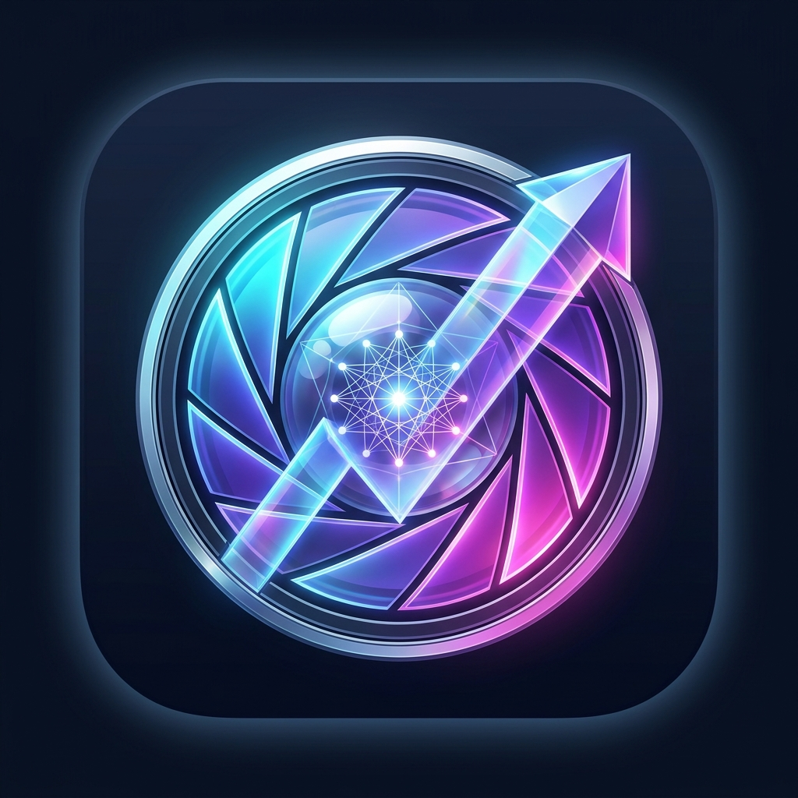

<!-- Compact Animated Documentation Header -->

  

  <a href="../README.md"><b>⬅️ Return to Main README</b></a> •
  <a href="../LICENSE"><b>📜 License (MIT)</b></a> •
  <a href="../CODE_OF_CONDUCT.md"><b>🤝 Code of Conduct</b></a> •
  <a href="../SECURITY.md"><b>🔒 Security Policy</b></a>

---

# 📚 Technical Documentation Hub

Welcome to the **CareerLens AI** technical documentation library. Below is a structured index of all architectural designs, API endpoints, security standards, and operational guidelines:

| Document | Focus & Scope | Description |
|---|---|---|
| [📖 API Documentation](API_DOCUMENTATION.md) | **REST API & Endpoints** | Complete FastAPI endpoint reference, request/response payloads, authentication, and error codes. |
| [🏗️ System Architecture](ARCHITECTURE.md) | **System Architecture** | High-level system design, data flow diagrams, microservices, and technology choices. |
| [🗄️ Database Design](DATABASE_DESIGN.md) | **Data Models & Schema** | SQLite/PostgreSQL schema specification, tables, foreign keys, indexes, and migrations. |
| [🚀 Deployment Guide](DEPLOYMENT.md) | **Production Deployment** | Cloud deployment procedures, Docker containerization, systemd services, and reverse proxies. |
| [📋 Project Requirements](PROJECT_REQUIREMENTS.md) | **Functional Specs** | Product requirements document (PRD), feature matrix, user stories, and acceptance criteria. |
| [🔒 Security Policy](SECURITY.md) | **Security & Compliance** | Level-4 RBAC rules, token encryption, GDPR Article 17 compliance, and vulnerability reporting. |
| [🧪 Testing Framework](TESTING.md) | **Quality Assurance** | Pytest suites, frontend component tests, IR vector benchmarks, and continuous integration. |
| [🎨 UI/UX Guidelines](UI_UX_GUIDELINES.md) | **Design System** | Design tokens, color palettes, responsive typography, and accessibility (WCAG 2.1 AA) standards. |

---

### 📂 Diagrams & Visual Assets
* [`docs/diagrams/`](diagrams/): Architectural sequence diagrams, ER diagrams, and state machines.
* [`docs/screenshots/`](screenshots/): Visual previews of the dashboard, ATS auditor, and admin console.

---

<a href="../README.md"><b>⬆️ Back to Project Root</b></a>

  

<!-- Documentation Footer Wave -->

